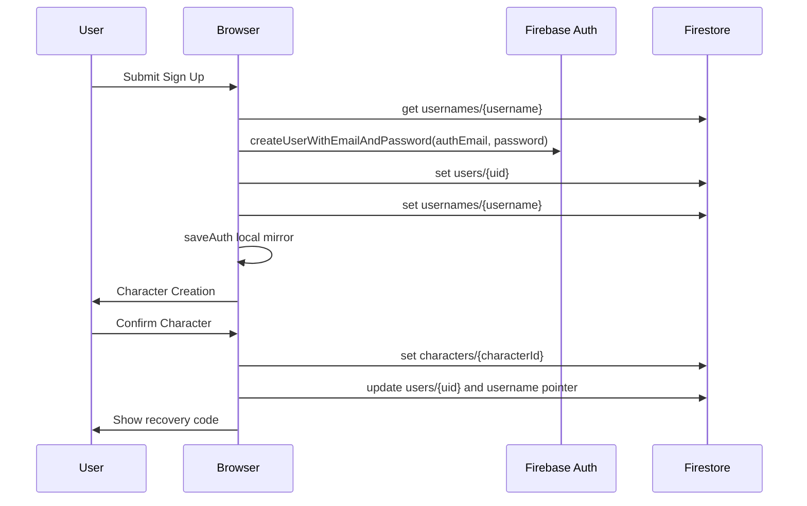

# Account Management Implementation

Last verified: 2026-08-31

This document describes the current implementation path from account creation to
password recovery and Super Admin user management. It documents the code that
exists today; it is not a proposal for the final hardened auth system.

## Source Files

- `shared/profile-hub.js`: auth orchestration, signup, login, recovery reset,
  character creation handoff, and local auth mirror.
- `shared/profile-login.js`: Sign In, Sign Up, and recovery form HTML.
- `shared/profile-auth.js`: username normalization, internal auth email mapping,
  and blocked-account helpers.
- `shared/profile-cloud.js`: Firebase Auth/Firestore access boundary.
- `shared/profile-session.js`: local auth/session mirror and Firebase trust flag.
- `shared/profile-recovery.js`: recovery code generation and hashing.
- `admin/app.js`: Super Admin Portal gate, user list, lifecycle actions, admin
  password reset, draft board/user tools, and publish flow.
- `api/admin-delete-status.js`: reports whether privileged delete backend env
  vars are present.
- `api/admin-delete-user.js`: backend-only permanent delete using Firebase Admin
  SDK.
- `api/recover-account.js`: backend password reset with Recovery ID.
- `api/admin-reset-user.js`: backend Super Admin temporary password reset.
- `api/account-recovery-core.js`: shared backend recovery/reset helpers.
- `firestore.rules`: deployed access rules for users, usernames, characters,
  invites, player modules, and admin revisions.
- `data-contracts.md`: canonical Firestore/localStorage shape.

## Platform Shape

The project uses Firebase Auth and Firestore under project
`pointy-personal-toolkit`. Current billing state is Spark: `billingEnabled:
false`. Spark still allows Firebase Auth and Firestore CRUD inside free quotas;
Blaze is not required merely for users to sign up or for admins to edit
Firestore documents.

Privileged permanent delete does not run in Firebase Cloud Functions. It runs as
Vercel Serverless API code using `firebase-admin` and service-account env vars.

```mermaid
flowchart LR
  "Player Browser" --> "Firebase Auth"
  "Player Browser" --> "Firestore Client SDK"
  "Admin Portal" --> "Firebase Google Auth"
  "Admin Portal" --> "Firestore Client SDK"
  "Admin Portal" --> "Vercel API /api/admin-delete-user"
  "Vercel API /api/admin-delete-user" --> "Firebase Admin SDK"
  "Firebase Admin SDK" --> "Firebase Auth"
  "Firebase Admin SDK" --> "Firestore"
```

## Identity Model

Core identifiers:

- `uid`: Firebase Auth UID. This is the durable owner key for `users/{uid}` and
  owner checks.
- `username`: user-facing login name. The player types this instead of an email.
- `authEmail`: internal Firebase Auth email generated from username. Normal
  signup uses `username@coinquest.local`. Recovery preserves the current Auth
  email and UID; legacy suffixed emails remain valid login pointers.
- `userId`: public four-digit app identity.
- `characterId`: active character identity. Current player loop is one active
  character per user.

Important collections:

- `users/{uid}`: account profile, public User ID, display name, active
  character, status, recovery data, provider.
- `usernames/{username}`: lookup from username to current `uid`, `authEmail`,
  `userId`, `characterId`, recovery hash, and lifecycle/tombstone status.
- `characters/{characterId}`: active character profile with `ownerUid`.
- `trips/{tripId}`: Party Ledger boards and participant links.
- `adminRevisions/{revisionId}`: Admin Portal publish/change log.

## User Creates Account

Entry:

- `shared/profile-login.js` renders the Sign Up form.
- `shared/profile-hub.js` handles `[data-login-form]` submit when
  `loginMode === "up"`.

Implementation flow:

1. Normalize the typed username with `normalizeUsername`.
2. Validate display name, username, password length, and password confirmation.
3. Read `usernames/{username}` through `usernameRecord`.
4. Reject existing active usernames. A reusable deleted tombstone can be reused
   so the same username can regain the same public User ID.
5. Generate a recovery code with `PointyRecovery.generateCode`.
6. Hash it as `sha256(username + ":" + normalizedRecoveryCode)`.
7. Create Firebase Auth user:
   `createUserWithEmailAndPassword(username@coinquest.local, password)`.
8. Set Firebase Auth display name to the normalized username.
9. Allocate `userId`:
   - reuse `existing.userId` when signing up through a reusable tombstone;
   - otherwise derive a stable four-digit ID from UID and fall back to random
     four-digit probes if already taken.
10. Write `users/{uid}` via `saveCloudUser`; this stores the recovery hash but
    not the raw Recovery ID.
11. Write `usernames/{username}` via `saveUsernameRecord`; this stores the login
    pointer but not a public recovery hash.
12. Write/backfill `userIds/{userId}` as a low-detail collision reservation.
13. Mirror account into `localStorage.pointy_auth_v1` through `saveAuth`.
14. Route the new account into Character Creation because `character` is still
    `null`.
15. After class/gender/name selection, `saveCloudCharacter` writes
    `characters/{characterId}` and updates `users/{uid}.character` plus
    `usernames/{username}.characterId`.
16. Show the recovery code once from
    `sessionStorage.pointy_pending_recovery_code_v1`.



## User Signs In

Entry:

- `shared/profile-login.js` renders the Sign In form.
- `shared/profile-hub.js` handles the same `[data-login-form]` submit when
  `loginMode === "in"`.

Implementation flow:

1. Normalize typed username.
2. Resolve Auth email through a fresh server read of
   `usernames/{username}.authEmail`; fall back to `username@coinquest.local`
   only when the live username mapping does not exist.
3. Call `signInWithEmailAndPassword(authEmail, password)`.
4. Load `users/{uid}` through `loadCloudAccount` with a fresh server read.
5. If the account document is missing, create a minimal `users/{uid}` document
   from the Firebase Auth user.
6. Reject blocked lifecycle statuses through `isBlockedAccountStatus`.
7. Mirror the loaded account into local session/auth storage.
8. If no active character exists, route to Character Creation; otherwise refresh
   the app shell/profile UI.

## User Resets Password With Recovery Code

Entry:

- Sign In screen `Forgot password?` opens the recovery form rendered by
  `shared/profile-login.js`.
- `shared/profile-hub.js` handles `[data-recovery-form]` and calls
  `recoverWithCode(username, code, password)`.

Production reset is backend-mediated through `/api/recover-account`, not a
client-side recovery hash comparison. `?test=1` can still exercise the legacy
local flow for regression fixtures.

Flow:

1. Normalize username.
2. POST username, Recovery ID, and new password to `/api/recover-account`.
3. The backend reads `usernames/{username}` to find the current UID/auth email.
4. The backend verifies the submitted Recovery ID against
   `users/{uid}.recoveryHash`, with legacy fallback to
   `usernames/{username}.recoveryHash`.
5. On match, the backend updates the existing Firebase Auth user password. If
   the old Auth UID is missing, it recreates the Auth user with that same UID.
   Ownership, active lifecycle and the current hash are checked transactionally;
   a five-minute lease serializes resets and refresh tokens are revoked.
6. Preserve public identity from old data:
   - `userId`
   - display name
   - active `character`
   - `characterId`
7. Generate a new Recovery ID and hash.
8. Store only the new recovery hash on `users/{uid}`.
9. Delete any legacy public `usernames/{username}.recoveryHash` field while
   preserving the login pointer.
10. Upsert `userIds/{userId}` and update `characters/{characterId}.ownerUid`
    when a character exists.
11. Write `accountRecoveryEvents`.
12. Return the new raw Recovery ID once; the browser signs in with the updated
    credential, mirrors the account locally, and shows the new code.

## User Regenerates Recovery Code

Entry:

- Profile drawer recovery block in `shared/profile-hub.js`.

Flow:

1. Current signed-in account calls `regenerateRecoveryCode`.
2. New code and hash are generated.
3. In production, `saveCloudUser` updates `users/{uid}` with the new recovery
   hash and deletes/avoids `usernames/{username}.recoveryHash`.
4. After the server write succeeds, the local auth mirror is updated for the
   signed-in browser session.

Server-backed recovery decisions must use the latest server hash/mapping. Local
drawer state or a previously revealed recovery code is a convenience mirror, not
the authority for reset validation.

The profile drawer can display the current recovery code for the signed-in
owner. This is an intentional small-private-app convenience tradeoff documented
in `data-contracts.md`; it should be revisited before any broader/public launch.

## Admin Portal Access

Entry:

- `/admin/` loads `admin/index.html` and `admin/app.js`.

Production gate:

1. Firebase compat Auth is initialized.
2. Admin signs in through `firebase.auth.GoogleAuthProvider`.
3. `isAllowedAdmin` only accepts `purich.wc@gmail.com`.
4. `isUnlocked()` returns true only for that allowlisted Google-auth user.
5. `?test=1` uses a local test gate for automated regression only. It is not
   production security.

Data load:

1. `loadPublished()` reads `trips`.
2. It reads recent `adminRevisions`.
3. It reads all `users` into `cloudUsers`.
4. It reads reusable username tombstones from `usernames` where
   `deleteReusable == true`.
5. It merges cloud users with board-derived participant/admin data for the User
   Management screens.

## Admin Portal User Management

Primary surfaces:

- Users list: `renderUsers`
- User detail: `renderUserDetail`
- Support tools: reset password, export, merge placeholder, invite admin,
  add user placeholder

### Add User

`showAddUserModal()` currently opens a support-style modal for selecting an
existing user and board. Its Confirm path only records a local support action:
`supportAction("Add user", "Prepared board user link")`.

Board-detail `addUser(boardId)` is a draft-board helper that appends a typed
participant name and random four-digit character ID to that board draft.

Current limitation: Admin Portal Add User is not a full Firebase Auth account
creation path. Real account creation is still the player Sign Up flow, while
admin reset can create a new credential for an existing/recovering username.

### Edit Character

`showEditCharModal` and `saveEditedCharacter` edit character presentation inside
Admin Portal draft board data:

- participant display name;
- class in `board.data.heroClasses`;
- XP in `board.data.characterXp`.

After publish, these changes are written into `trips/{tripId}`. This does not
currently update the canonical `users/{uid}.character` or
`characters/{characterId}` document.

### Lifecycle: Archive, Deactivate, Delete Requested

`showUserLifecycleModal` and `applyUserLifecycle` update local lifecycle state
and, in production, patch:

- `users/{uid}` with status fields;
- `usernames/{username}.lifecycleStatus`.

Login blocks deactivated/deleted-style statuses through
`isBlockedAccountStatus`. These lifecycle changes are client SDK writes allowed
by Super Admin rules, not Admin SDK operations.

### Admin Password Reset

`showResetPwModal` collects:

- username;
- temporary password;
- optional User ID to preserve.

`performAdminPasswordReset` calls `/api/admin-reset-user` with the Google-auth
Super Admin Firebase ID token:

1. Verify the Super Admin token server-side.
2. Read `usernames/{username}` and `users/{uid}` through Firebase Admin SDK.
3. Update the existing Firebase Auth user's password when the UID exists; create
   the Auth user with the same UID only when missing. Blocked accounts remain
   blocked; mismatched identity ownership or an active reset lease aborts.
4. Generate new Recovery ID and hash.
5. Preserve old `userId`, display name, character, and character pointer when
   available.
6. Write `users/{uid}` with the new hash but no raw Recovery ID.
7. Update `usernames/{username}` and delete any legacy public recovery hash.
8. Upsert `userIds/{userId}`.
9. Update `characters/{characterId}.ownerUid` if a character exists.
10. Write `accountRecoveryEvents`.
11. Show temporary password and new Recovery ID for one-time handoff to the user.

### Permanent Delete

Permanent delete is backend-only.

Admin UI:

1. `checkAdminDeleteBackend()` calls `/api/admin-delete-status`.
2. If service-account env vars are missing, permanent delete is disabled.
3. `showPermanentDeleteModal` requires an audit reason and exact text
   confirmation: `DELETE <userId>`.
4. `performPermanentDeleteRequest` sends the Google-auth Firebase ID token to
   `/api/admin-delete-user`.

Backend:

1. `api/admin-delete-user.js` verifies the ID token.
2. It rejects anyone except verified `purich.wc@gmail.com`.
3. It resolves the target by UID/User ID/username/character IDs.
4. For Auth-linked accounts, it deletes the Firebase Auth user, deletes
   `users/{uid}`, deletes character docs, writes `usernames/{username}` as a
   reusable deleted tombstone, writes `adminDeleteRequests`, and cleans trip
   references.
5. For legacy no-auth references, it attempts legacy board/character cleanup and
   writes audit status.

## Firestore Rules Summary

Current rule shape:

- `characters`: public read; owner or Super Admin create/update; Super Admin
  delete.
- `users`: owner or Super Admin get; Super Admin list; owner or Super Admin
  create/update; raw `recoveryCode` writes are blocked; Super Admin delete.
- `usernames`: public get, no list; owner/Super Admin create; owner can preserve
  same UID; deleted reusable tombstone can be reclaimed only while preserving
  same username/User ID; new public `recoveryHash` writes are blocked; Super
  Admin delete.
- `userIds`: public get, no list; owner/Super Admin create/update with same-ID
  tombstone reclaim; Super Admin delete.
- `playerModules`: owner or Super Admin read/create/update; Super Admin delete.
- `adminRevisions`: Super Admin only.
- `trips`: signed-in users can read/create/update; only Super Admin can delete.

The `trips` rule is no longer anonymous-public, but it is still not
owner/member-scoped. Tightening board permissions needs an access-metadata
migration and regression coverage.

## Spark vs Blaze Reality

This account system does not require Blaze just because it creates accounts or
lets the Admin Portal edit Firestore user data.

Spark supports:

- email/password Firebase Auth signup/login;
- Google sign-in provider when configured;
- Firestore reads/writes/deletes within free quotas;
- client SDK writes allowed by security rules;
- Vercel-hosted backend routes using Firebase Admin SDK credentials.

Blaze becomes relevant when a selected Firebase/Google Cloud feature explicitly
requires billing, the app needs paid overflow beyond free quotas, or a chosen
server/runtime requires a billing-enabled Google Cloud project.

## Invariants And Caveats

- Username is the login handle; real external email is not required for player
  accounts.
- `usernames/{username}` is the login pointer. When it moves, future username
  login follows the new UID/auth email.
- Recovery/admin reset updates the existing Auth user; missing Auth is recreated
  with the same UID so modules, invitations and board links retain their owner.
- Public `userId` and `characterId` should be preserved across recovery/reset.
- One active character per user is current canon.
- Admin Portal Add User is not yet true account creation.
- Admin character edits mostly affect board draft/published board data, not the
  canonical character document.
- `?test=1` is regression-only and should never be described as production
  security.
- Any change to account flow should run `npm test` and should include targeted
  auth/admin/manual browser verification.
## Backend repair notes — 2026-10-12

Web signup now provisions user, username and User ID in one transaction, retains
a pending recovery reveal across interrupted provisioning, and prevents the Auth
watcher from creating a competing profile during signup. User ID collisions
retry without creating another Auth identity. Character creation links the user
and character atomically and preserves existing progression. Reads do not invent
a replacement User ID for an incomplete profile.

Recovery/admin reset preserve UID, including when Auth must be recreated; blocked
accounts stay blocked. A transaction validates the current key and holds a bounded
reset lease. Failed Auth operations release the lease and retain the old key hash;
successful operations rotate the key and revoke sessions. The production deploy
must include the API and updated rules together. Deployment evidence belongs in
`DEPLOYMENT_AND_ROLLBACK_RUNBOOK.md` and the exact release's CI record.

Admin lifecycle writes both status fields across user, username and ID reservation
atomically. Permanent deletion detaches the account from shared boards as a guest
without changing historical money. See `docs/backend-audit-2026-10-12.md`.
