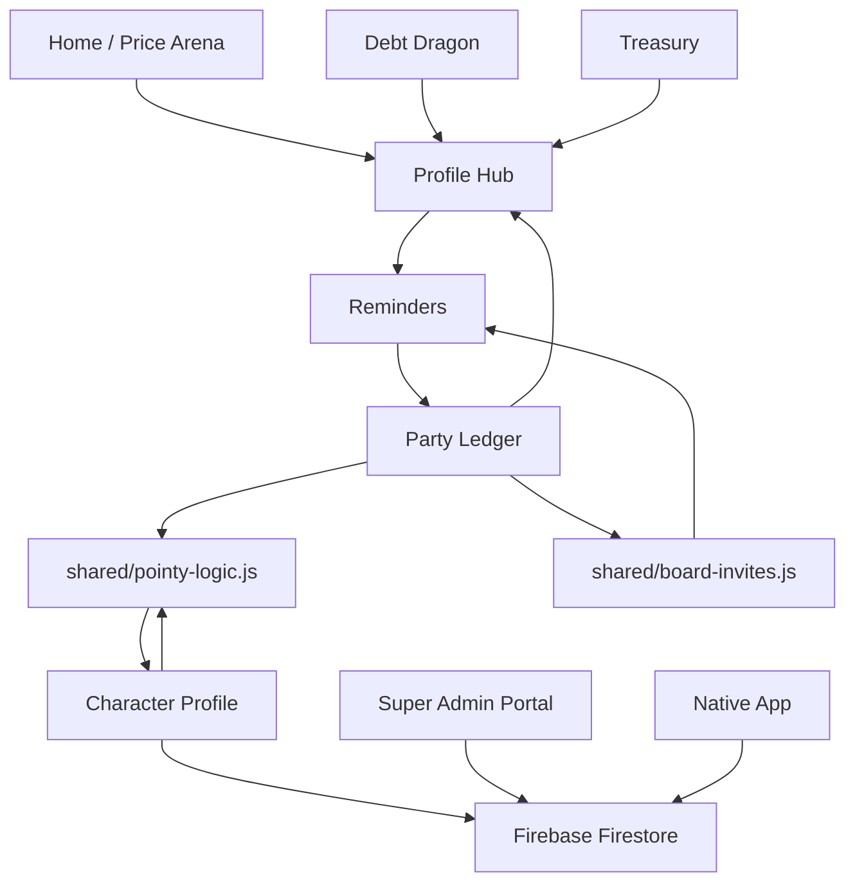
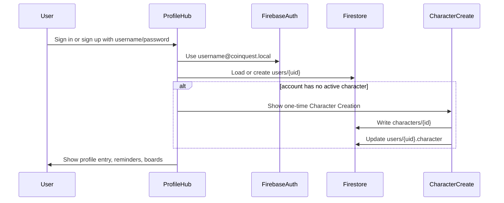
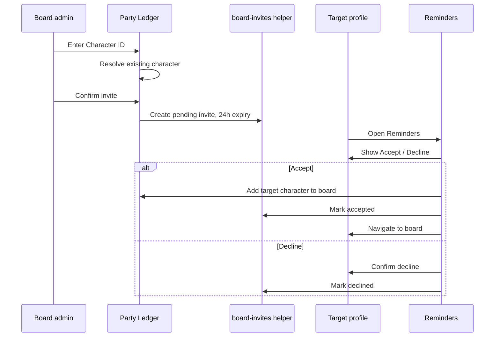
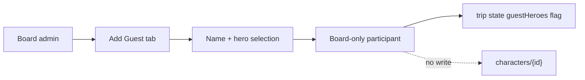
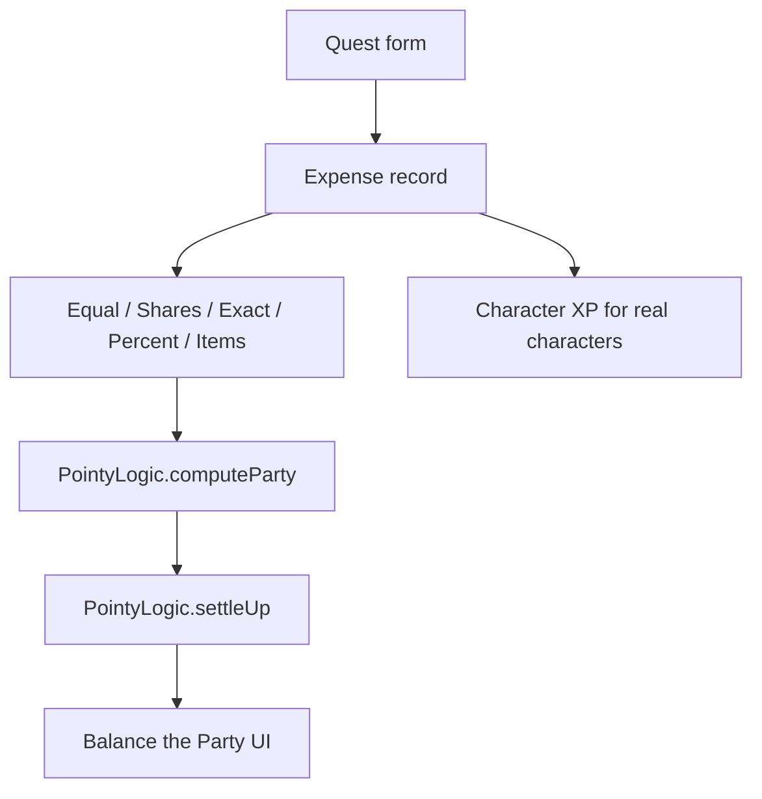

# Site Map And Interactions

Last updated: 2026-06-30

## Purpose

This file maps routes, modules, shared dependencies, and cross-surface user
flows. It answers "what talks to what?" rather than "where is this file?".

Use `PROJECT_STRUCTURE_GUIDE.md` for file lookup and `data-contracts.md` for
persisted shapes.

## Route Map

| Route | Surface | Primary files | Owns |
| --- | --- | --- | --- |
| `/` | Home / Price Arena | `index.html` | launcher, compare offers, shared profile entry |
| `/trip/?id=...` | Party Ledger | `trip/index.html`, `trip/app.js` | board state, expenses, participants, settlements, imports/exports |
| `/character/?id=...` | Character Profile | `character/index.html`, `character/app.js` | public character view, board aggregation, privacy display |
| `/debt/` | Debt Dragon | `debt/index.html`, `debt/app.js` | debt payoff web module |
| `/treasury/` | Treasury | `treasury/index.html`, `treasury/app.js` | treasury/budget web module |
| `/admin/` | Super Admin Portal | `admin/index.html`, `admin/app.js`, `admin/admin.css` | boards, users, admins, revisions, support tools |
| `mobile/` | Native player app | `mobile/App.tsx`, `mobile/src/*` | native player identity and module UI |

## High-Level Dependency Graph

## Shared Concepts

- Account: Firebase Auth user plus `users/{uid}` profile.
- User ID: public four-digit account/person identity.
- Character ID: public four-digit playable hero identity.
- Board ID / Trip ID: Party Ledger board route and Firestore document ID.
- Admin ID: Board Admin identity that can repeat across multiple boards.
- Guest Hero: board-only participant without real Character ID.
- Reminder: profile-hub overlay item; includes board invites and module notices.

## Core Interaction Flows

### Login And Character Creation

### Board Invite By Character ID

### Add Guest

### Log Quest And Settle

## Side Effects By Flow

| Flow | Reads | Writes | Notes |
| --- | --- | --- | --- |
| Sign in | Firebase Auth, `users/{uid}` | `localStorage.pointy_auth_v1` mirror | Mirror is authoritative only in `?test=1` |
| Sign up | `usernames/{username}` | Auth user, `users/{uid}`, `usernames/{username}` | Username maps to internal auth email |
| Character Creation | class registry, assets | `characters/{id}`, `users/{uid}.character` | One active character per account |
| Add real hero by ID | `characters/{id}` or test registry | `users/{uid}/boardInvites/{id}` | Sends invite, does not add immediately |
| Accept invite | invite doc, `trips/{id}` | `trips/{id}`, invite status | Adds target character to board |
| Decline invite | invite doc | invite status | Requires confirmation |
| Add Guest | local UI state | `trips/{id}.guestHeroes` and hero maps | No real Character ID |
| Log Quest | board state | `trips/{id}.expenses`, XP-derived state | Uses split math |
| Settlement | board expenses | no required write | Pairwise obligation math |
| Admin publish | Firestore boards/users | `trips`, `users`, `adminRevisions` | Production access is allowlisted Google Auth |
| Native module save | `playerModules/{uid}` | `playerModules/{uid}` | Native-only Debt/Treasury/Compare state |

## Cross-Module Risk Notes

- `shared/profile-hub.js` is loaded by multiple pages; profile UI changes can
  affect Home, Trip, Debt, Treasury, Character Profile, and Admin-adjacent flows.
- `shared/pointy-logic.js` is shared math; settlement, price ranking, leveling,
  class metadata, and profile aggregation can all be affected by one edit.
- `shared/mobile-shell.*` affects Home/Compare, Split, Debt, Prices, and
  Treasury at phone widths.
- Party Ledger participant keys are display names; duplicate visible names are
  allowed, but object-key collisions still need local disambiguation.
- Real Character ID flows and Guest flows must remain separate.
- Admin user lifecycle can block player login, so auth changes should consider
  archived/deactivated/delete-requested/deleted states.
- Firestore rules must match the client flow before production testing.

## Verification Map

- Route wiring: open each route through `npm run serve`, not `file://`.
- Shared shell: check phone, tablet, and desktop after changing
  `shared/mobile-shell.*` or profile topbar/drawer code.
- Board invites: test the admin invite path plus target Accept and Decline.
- Guest path: confirm no Character ID or registry write is created.
- Settlement: run unit tests for `PointyLogic.settleUp`.
- Claude visual work: follow `CLAUDE_TO_A_TEE_QA.md`.

