# Site, Journey, And Interaction Map

Last updated: 2026-07-14

## Purpose

This is the canonical map for how Coin Quest Ledger is connected across player
and admin surfaces. It answers:

- where each route lives;
- what each surface owns;
- how users move through the product;
- which modules read/write shared state;
- which interactions are local-only, Firestore-backed, or backend-only.

Use `PROJECT_STRUCTURE_GUIDE.md` for file lookup, `data-contracts.md` for
persisted shapes, `ACCOUNT_MANAGEMENT_IMPLEMENTATION.md` for auth/account/admin
identity flows, and `INVITES_AND_GUESTS.md` for participant-entry canon.

## Product Boundaries

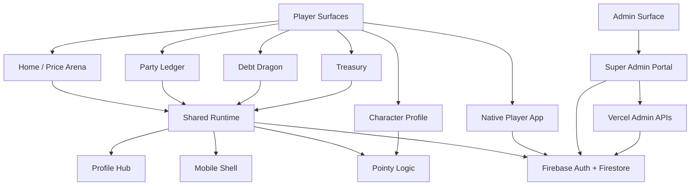

Player surfaces are for normal account, character, board, and module use.
`/admin/` is the only production Super Admin surface. The native app is
player-side only and must not be treated as an Admin WebView or admin app unless
the user explicitly changes direction.

## Route Map

| Route | Audience | Primary files | Owns | Key shared dependencies |
| --- | --- | --- | --- | --- |
| `/` | Player | `index.html` | Home Hub, toolbox launcher, Price Arena | `shared/profile-hub.*`, `shared/mobile-shell.*`, `shared/pointy-logic.js` |
| `/trip/?id=...` | Player / Board Admin | `trip/index.html`, `trip/trip-utils.js`, `trip/app.js`, `trip/pixicons.jsx` | Party Ledger board, expenses, participants, campaigns, settlement, imports/exports | `shared/pointy-logic.js`, `shared/board-invites.js`, profile modules |
| `/trip/` | Player | `trip/index.html`, `trip/trip-utils.js`, `trip/app.js` | new/open board chooser and generated board IDs | profile modules, Firestore/test storage |
| `/character/?id=...` | Player / Admin reference | `character/index.html`, `character/app.js` | public character profile, board aggregation, privacy view | `shared/pointy-logic.js`, Firebase compat SDK |
| `/debt/` | Player | `debt/index.html`, `debt/app.js` | web Debt Dragon local-first module | profile modules, account scope, assets |
| `/treasury/` | Player | `treasury/index.html`, `treasury/app.js` | web Treasury local-first module | profile modules, account scope |
| `/admin/` | Super Admin | `admin/index.html`, `admin/admin-utils.js`, `admin/app.js`, `admin/admin.css` | board/user/admin management, relationship map, lifecycle, revisions, support tools | Firebase Google Auth, Firestore, `api/admin-delete-*` |
| `mobile/` | Player native | `mobile/index.ts`, `mobile/src/app/*` | Expo Router player app for auth, profile, Split and finance modules | Firebase modular SDK + shared calculations |
| `/api/admin-delete-status` | Admin backend | `api/admin-delete-status.js` | reports privileged delete readiness | Vercel env |
| `/api/admin-delete-user` | Admin backend | `api/admin-delete-user.js` | verifies Super Admin token and permanently deletes account data | Firebase Admin SDK |

## Shared Module Map

| Module | Used by | Responsibility | Risk if changed |
| --- | --- | --- | --- |
| `shared/profile-hub.js` | Home, Split, Debt, Treasury | auth gate, profile drawer, reminders, character creation, board invite accept/decline, account mirrors | changes can affect every player page |
| `shared/profile-login.js` | Profile Hub | Sign In, Sign Up, recovery form rendering | copy/layout changes affect auth entry |
| `shared/profile-character-create.js` | Profile Hub | one-time character creation UI | class/gender/skin selection must stay compatible |
| `shared/profile-reminders.js` | Profile Hub | reminder overlay renderer | invite accept/decline controls depend on action attributes |
| `shared/profile-auth.js` | Profile Hub, tests | username normalization, internal auth email, blocked statuses | can break login/recovery/lifecycle blocks |
| `shared/profile-session.js` | Profile Hub, account scope | local auth/session mirror and trusted Firebase flag | stale local data can leak into production if mishandled |
| `shared/profile-cloud.js` | Profile Hub | Firebase Auth/Firestore access boundary | all real account flows depend on it |
| `shared/board-invites.js` | Split, Profile Hub | invite payloads, expiry, persistence, status updates | real-vs-guest participant separation |
| `shared/pointy-logic.js` | all player modules, Admin | split math, settlement, class registry, XP/levels, profile aggregation | central behavioral dependency; unit-test changes |
| `shared/account-scope.js` | player modules | account-scoped localStorage keys | prevents stale cross-account progress |
| `shared/mobile-shell.*` | Home, Split, Debt, Treasury | phone hamburger drawer and bottom tab shell | mobile navigation and safe layout |
| `shared/asset-urls.js`, `shared/cloudinary-assets.js` | asset-heavy pages | resolves local/remote assets | production `?test=1` must still use manifest-backed assets; broken paths affect portraits/icons/dragons |

## Navigation And Deep Links

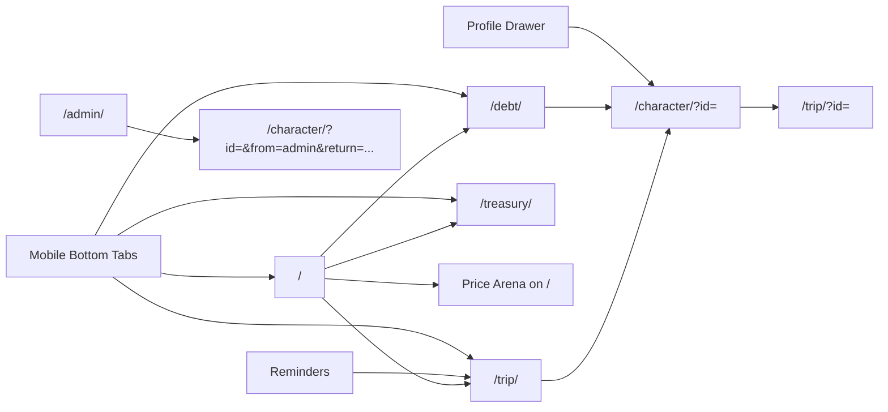

Important route behavior:

- `?test=1` switches multiple player/admin surfaces into regression fixtures and
  local/session storage. Do not describe it as production security.
- `/character/?private=1` hides money values for display privacy. It is not an
  authorization boundary.
- Character profile links from Admin include return parameters so the admin can
  navigate back to `/admin/?tab=users`.
- Profile drawer board links preserve test mode when active.
- Mobile shell adds test query parameters when navigating from a test page.

## Player Journey Map

### First Visit / Home Hub

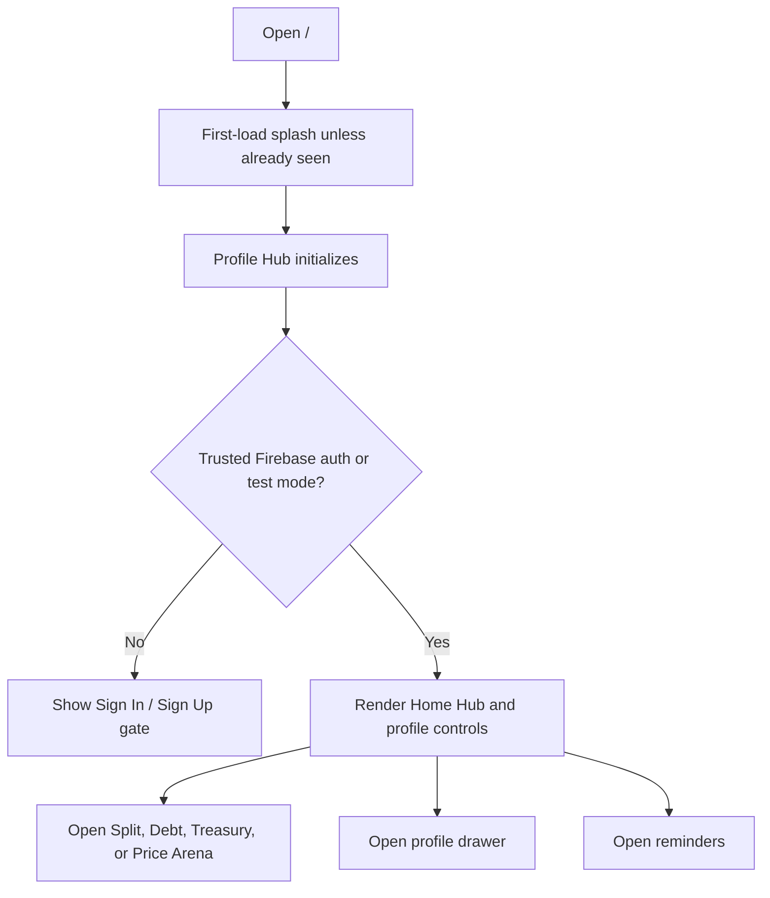

Interactions:

- Home cards navigate to `/trip/`, `/debt/`, and `/treasury/`.
- Price Arena stays on `/` and uses `shared/pointy-logic.js`.
- Topbar profile controls are injected by `shared/profile-hub.js`.
- Phone navigation is injected by `shared/mobile-shell.js`.

### Account Creation And Character Creation

See `ACCOUNT_MANAGEMENT_IMPLEMENTATION.md` for the implementation-level version.

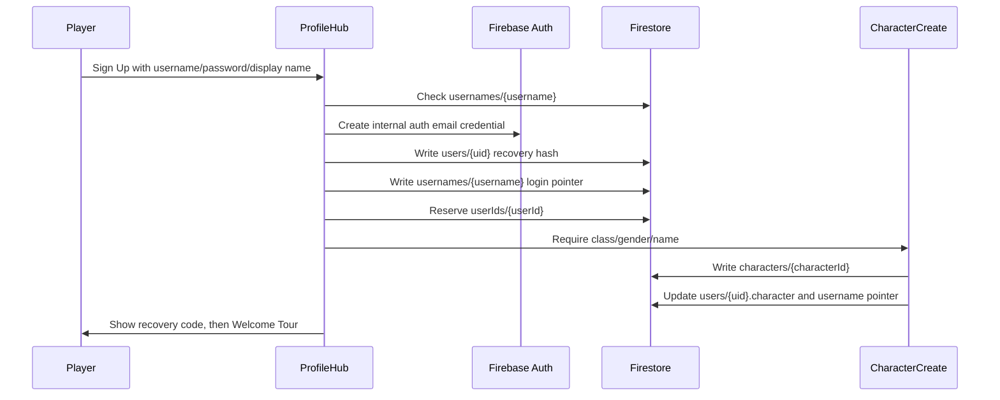

Main side effects:

- Firebase Auth user is created with an internal `@coinquest.local` email.
- `users/{uid}` and `usernames/{username}` are created or reclaimed from a
  reusable tombstone.
- `characters/{id}` is created after character confirmation.
- `localStorage.pointy_auth_v1` mirrors the account for the browser session.

### Sign In / Recovery

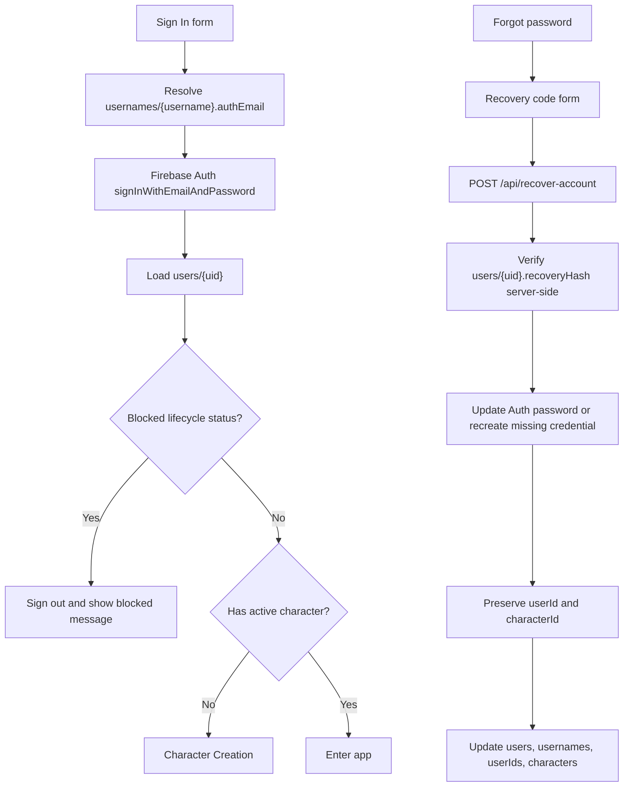

Production reset is backend-mediated and prefers in-place Auth password update
when the current UID still exists. The browser receives the new Recovery ID once
and then signs in with the updated credential.

### Party Ledger Board Journey

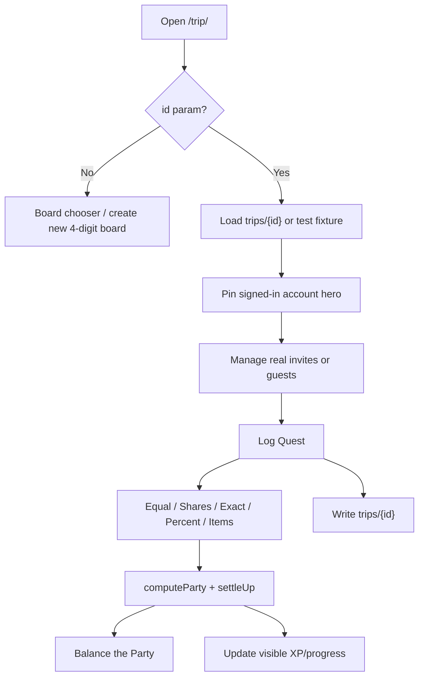

Key interactions:

- New boards get four-digit IDs and creator/admin metadata.
- Signed-in account hero is pinned from profile; the UI must not ask for
  "Other hero's name" for this path.
- Real other heroes are invited by existing Character ID.
- Guests are board-local and never create real Character IDs.
- Settlement must use pairwise per-expense obligations with reciprocal netting.

### Real Character Invite Journey

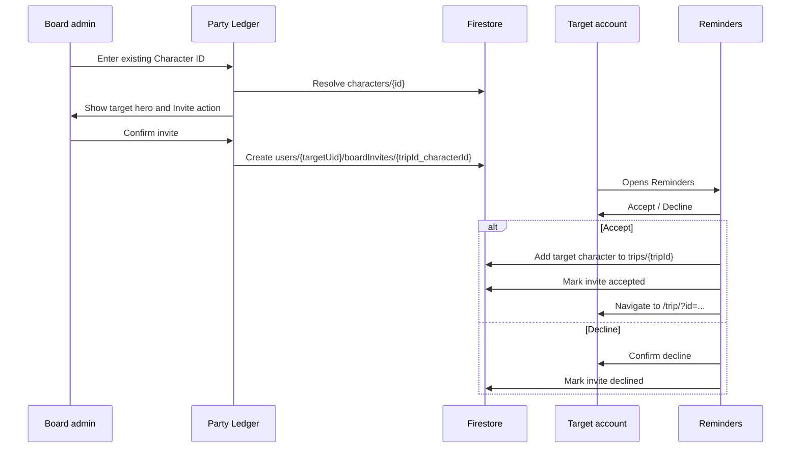

Rules:

- A Character ID invite does not immediately add the target to the board.
- Pending invites expire after 24 hours.
- Decline requires confirmation.
- Direct party invite links may join immediately, but unauthenticated users must
  be routed through login before joining.

### Guest Hero Journey

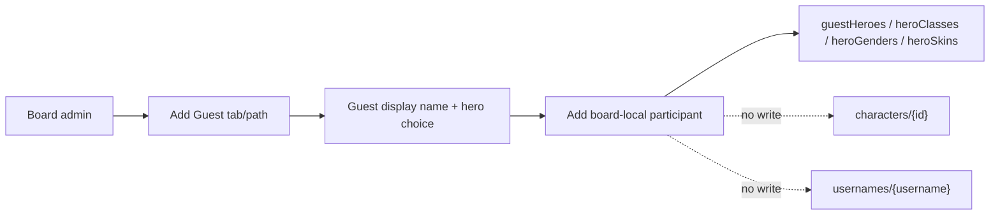

Guest rules:

- guest visible names may duplicate;
- guests do not get Character IDs;
- guests do not write to the character registry;
- guests can participate in expenses and settlement as board-local heroes.

### Reminders Journey

Reminders are generated by `shared/profile-hub.js` and rendered by
`shared/profile-reminders.js`.

Sources:

- board invites from `users/{uid}/boardInvites`;
- Debt Dragon overdue/due items from account-scoped local state;
- Treasury bills from account-scoped local state;
- settlement reminders from Party Ledger snapshots.

Interactions:

- Bell icon opens overlay.
- Invite reminders expose `Accept` and `Decline`.
- Generic reminders navigate to `/trip/`, `/debt/`, or `/treasury/`.
- Mobile shell can also open reminders from the drawer.

### Character Profile Journey

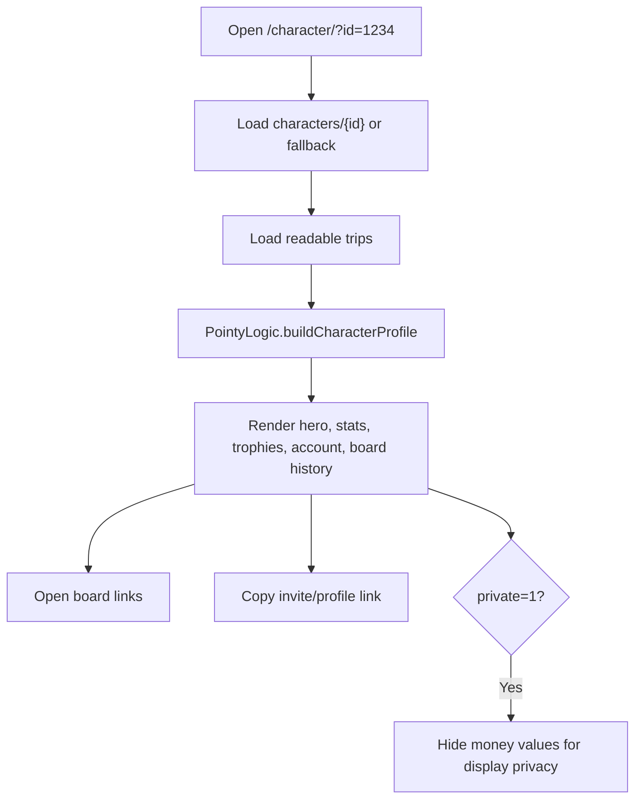

Admin can deep-link to character profiles with return parameters. Player modules
link to the signed-in character profile when a character is present.

### Debt Dragon Journey

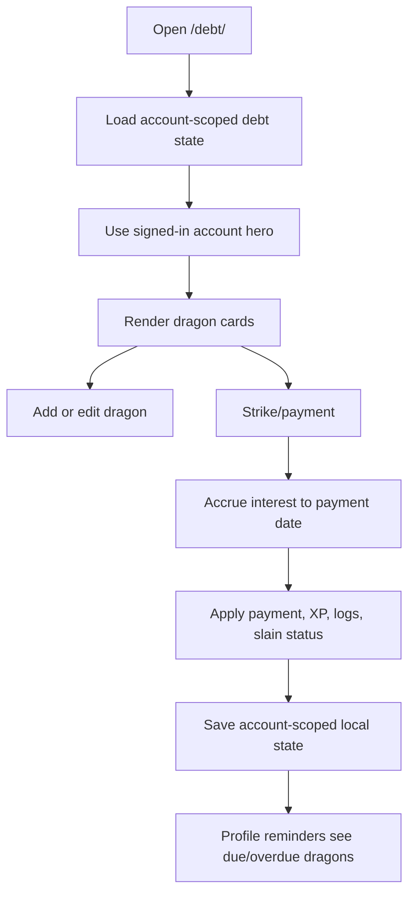

Web Debt Dragon keeps an account-scoped local cache and connects through
`shared/module-cloud.js` to the same `playerModules/{uid}` as native. Conflicting
unsynced local data is retained for an explicit choice. Verify the exact deployed
revision through the release runbook before asserting production availability.

### Treasury Journey

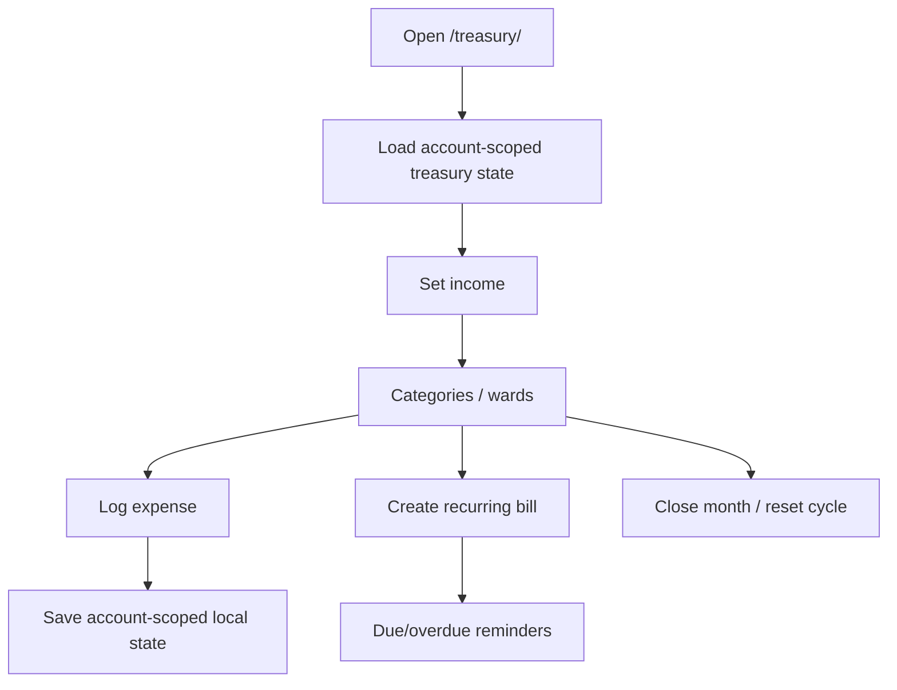

Web Treasury uses the same local-cache/cloud-bridge policy as Debt Dragon;
native writes the shared owner document directly with conflict detection.

### Price Arena Journey

Price Arena lives on `/` and uses `shared/pointy-logic.js` to normalize offers,
unit aliases, promotions, and rankings. It is a player utility, not a Board, and
does not create `trips` or Admin Portal records.

### Native Player App Journey

The old native app was retired on 2026-10-11. The new SDK 57 app implements the
following player journeys, with actual native and web/Firebase evidence recorded
in `docs/mobile-completion-worklist.md`:

- username/password Sign In and Sign Up;
- Character Creation and Profile;
- Split boards, five split modes, multi-payer, Guest editing, Character-ID invites,
  budgets, settlements/PromptPay, campaigns, receipts, imports and exports;
- Debt Dragon, Treasury, and Compare via `playerModules/{uid}`;
- reminders, 19 achievements, shared XP/reputation, privacy/share and recoverable history;
- account recovery and native backup/restore (live credential-changing QA needs a human handoff);
- no Admin Portal.

Native and web share calculations and Firebase records. The native UI uses local
bundled website fonts and art. Native does not read browser localStorage; the web
bridge is responsible for preserving/mapping existing browser data.

## Admin Journey Map

### Super Admin Entry

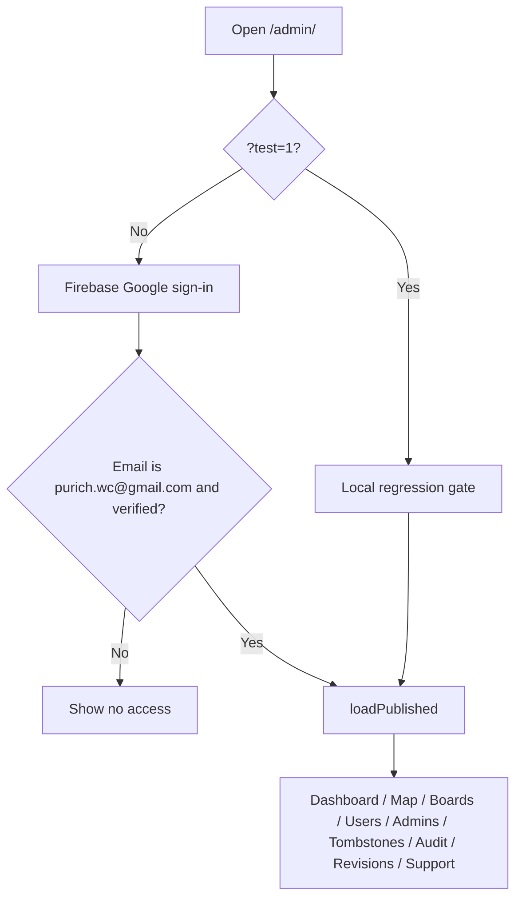

Production security depends on Firebase Auth, allowlisted Gmail, Firestore
Rules, and backend service-account env vars for destructive actions.

### Admin Navigation / Site Map

| Admin tab | Source functions | Main objects | Notes |
| --- | --- | --- | --- |
| Dashboard | `renderDashboard` | boards, users, admins, revisions | overview stats and activity |
| Relationship Map | `renderRelationshipMap` | users, characters, admins, boards | drill-in relationship view |
| Boards | `renderBoards`, `renderBoardDetail` | draft/published boards | board edits stay draft until publish |
| Users | `renderUsers`, `renderUserDetail` | cloud users + board-derived users | lifecycle, reset, export, character links |
| Board Admins | `renderAdmins`, `renderAdminDetail` | Admin IDs and owned boards | Admin IDs can repeat across boards |
| Deleted IDs | `renderTombstones` | reusable username tombstones | deleted usernames can be reclaimed |
| Audit | `renderAuditLog` | local/support audit style records | not a full event-sourced system |
| Revisions | `renderRevisions` | `adminRevisions` | publish history |
| Support | `renderSupportTools` | helper modals | export/reset/merge/invite/add placeholders |

### Board Draft And Publish Journey

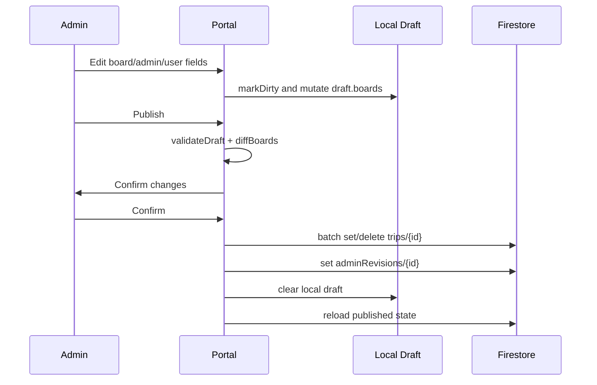

Board/admin/user edits inside Admin Portal generally do not affect production
until Publish, except account lifecycle and admin password reset which write
directly to user/auth collections.

Production Admin reads use server-source Firestore requests for `trips`,
`users`, `usernames`, and `adminRevisions`. Local Admin draft storage remains an
explicit unpublished work area, not a fallback that silently replaces the live
published state.

### Admin User Detail Journey

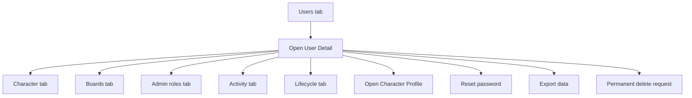

Important distinctions:

- Users list merges `users/{uid}` with board-derived participant/admin records.
- Some rows can be legacy/no-auth or board-derived rather than real Firebase
  account records.
- Admin "Add user" is not yet real Firebase Auth account creation.
- Admin character edits mostly mutate board draft data, not canonical
  `characters/{id}` or `users/{uid}.character`.

### Admin Lifecycle Journey

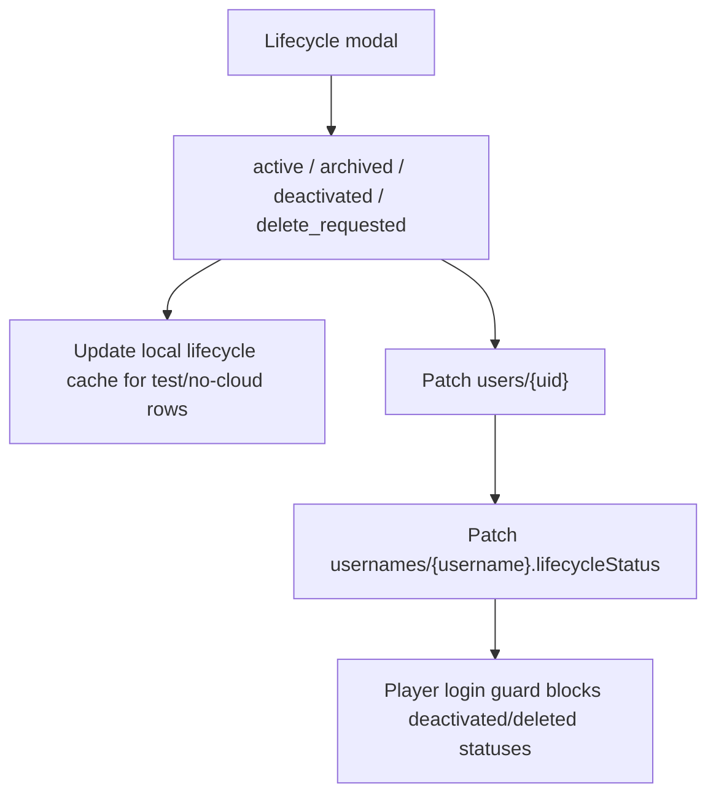

Lifecycle actions are recoverable status updates. They are not the same as
permanent delete.

### Admin Password Reset Journey

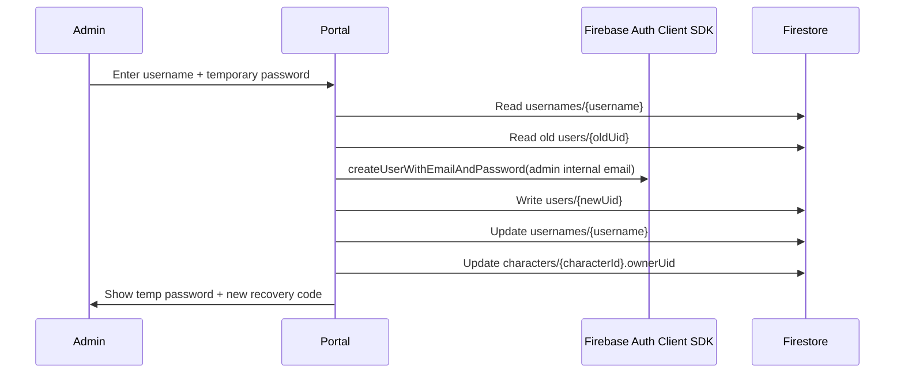

Caveat: this currently uses the browser client SDK, so creating the credential
can replace the current browser Firebase Auth session. For hardening, move this
flow behind the Vercel backend with Firebase Admin SDK.

### Permanent Delete Journey

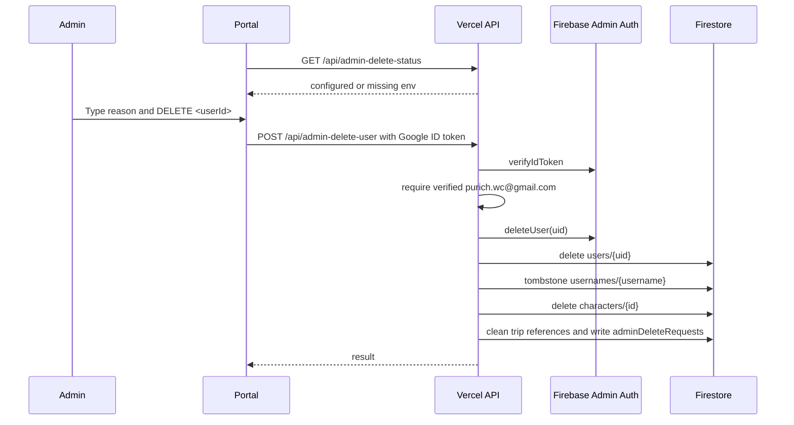

Permanent delete is the only current backend-only user management path.

## Interaction Map By State Store

| Store | Owner surfaces | Reads | Writes | Notes |
| --- | --- | --- | --- | --- |
| Firebase Auth | player auth, Admin gate, recovery/reset/delete APIs | Profile Hub, Admin Portal, backend API | signup, sign-in, backend recovery/admin reset, backend delete | player accounts use internal emails |
| `users/{uid}` | Profile Hub, Admin Portal, native, recovery APIs | owner profile, Admin Users, native modules | signup, recovery hash, character creation, lifecycle, native profile | owner/Super Admin scoped; raw Recovery ID is local reveal only |
| `usernames/{username}` | Profile Hub, Admin Portal, backend APIs | login resolution, tombstones | signup, login pointer, lifecycle, delete tombstone | public get; no list; new recovery hashes are not written here |
| `userIds/{userId}` | Profile Hub, native, backend APIs | collision reservation | signup/backfill/reset/delete tombstone | public get; no list; low-detail reservation only |
| `characters/{id}` | Profile Hub, Character Profile, Trip, Admin | profile pages, invite resolution, board links | character creation, owner pointer updates, backend delete | current active character canon is one per user |
| `trips/{id}` | Party Ledger, Character Profile, Admin Portal | boards, profile aggregation, Admin boards | Party Ledger saves, Admin publish, invite accept | production reads request server source; signed-in-only rule, owner/member scope pending |
| `users/{uid}/boardInvites/{id}` | Trip, Profile Hub | target reminders | Character ID invite create, accept/decline status | 24-hour pending lifecycle; reminders reload pending invites from server in production |
| `adminRevisions/{id}` | Admin Portal | revisions tab | Admin publish | Super Admin only in rules |
| `adminDeleteRequests/{id}` | backend/API audit | backend tests/ops | backend delete status | not full product audit log |
| `playerModules/{uid}` | Native app + web bridge | Debt/Treasury/Compare and profile/reminders | owner-scoped shared module state | local round trips verified; release status tracked separately |
| `localStorage.pointy_auth_v1` | Profile Hub | player pages | auth mirror | authoritative only in `?test=1`; production Firebase sessions must fresh-sync `users/{uid}` before trusting mirrored account state |
| account-scoped localStorage | web Debt/Treasury/Compare/Profile | player web modules/reminders | local module progress | scoped by active account; real production board data must not be replaced by trip snapshot cache |
| `sessionStorage.pointy_test_trip_*` | tests / `?test=1` | Trip/Admin test mode | Playwright fixtures/Admin test publish | regression-only |

## Overlay And Modal Map

| Overlay/modal | Owner | Opens from | Actions |
| --- | --- | --- | --- |
| Login Gate | `shared/profile-hub.js` + `profile-login.js` | app load when not trusted/signed in | sign in, sign up, forgot password |
| Recovery Code Overlay | `shared/profile-hub.js` | after signup/recovery/regeneration | copy, acknowledge |
| Character Creation | `shared/profile-hub.js` + `profile-character-create.js` | new account or sign-in without character | choose class/gender/name |
| Profile Drawer | `shared/profile-hub.js` + `profile-drawer.js` | topbar/mobile drawer profile action | view profile, recovery block, export/restore, sign out |
| Reminders | `shared/profile-hub.js` + `profile-reminders.js` | topbar/mobile drawer bell | accept/decline invite, navigate to due items |
| Welcome Tour | `shared/profile-hub.js` + `profile-tour.js` | after first character/recovery acknowledgement | onboarding navigation |
| Party Ledger hero picker | `trip/app.js` | participant setup | choose hero/class/guest/invite paths |
| Party Ledger quest form | `trip/app.js` | board page | log expense, split mode, receipt/date |
| Admin Portal modal | `admin/app.js` | admin actions | reset, lifecycle, delete, export, board/admin/user helpers |

## Player-To-Admin Boundary

- Player profile/board data can appear inside Admin Portal, but player pages
  should not gain Admin-only permissions.
- Admin Portal can link to Character Profile for inspection, with return params.
- Permanent delete must stay backend-only and must not be reimplemented as a
  client-side Firebase Auth delete.
- Admin lifecycle statuses must be respected by player login/session guards.
- Admin board draft edits do not become player-visible until Publish.

## Mobile And Tablet Interaction Map

Player web:

- `shared/mobile-shell.js` adds phone bottom tabs and drawer for Home/Split/Debt/Treasury.
- `shared/profile-hub.css` controls profile/recovery/reminder overlays across
  phone and desktop.
- Party Ledger, Debt Dragon, and Treasury each keep route-specific responsive
  layouts in their own HTML/CSS.

Admin web:

- `/admin/` does not use the player mobile shell.
- Admin CSS has its own breakpoints: sidebar becomes horizontal nav, dense
  tables scroll, and modals become bottom-sheet-like on narrow screens.

Native:

- `mobile/` is a separate Expo player app with Firebase modular SDK and native
  state contracts.

## Critical User Journeys To Test

Player:

- Sign Up -> Character Creation -> recovery code -> Welcome Tour.
- Sign In -> profile drawer -> full Character Profile.
- Forgot password -> recovery code -> new credential -> login with new password.
- Create/open Party Ledger board -> pin own hero -> invite real Character ID.
- Target account accepts and declines board invite from Reminders.
- Add Guest -> log expenses -> pairwise settlement.
- Debt Dragon add dragon -> strike/payment -> due reminder.
- Treasury income/category/bill/expense -> due reminder.
- Price Arena offer comparison.
- Character Profile privacy mode and board links.
- Mobile shell navigation on phone widths.

Admin:

- Google sign-in gate accepts only `purich.wc@gmail.com`.
- Dashboard and Relationship Map load cloud users/boards/admins.
- Board edit -> diff -> Publish -> `trips` and `adminRevisions`.
- User Detail -> Character Profile return flow.
- Lifecycle status update -> player login guard.
- Admin reset password -> username pointer moves to new credential.
- Permanent delete -> backend token verification -> tombstone -> recreate username.
- Deleted IDs tab shows reusable tombstones.
- Admin responsive tables/modals on tablet/mobile widths.

## Regression And Verification Map

| Change area | Minimum checks |
| --- | --- |
| Static route/script wiring | `npm run test:syntax`, open affected route through `npm run serve` |
| Shared profile/auth/reminders | targeted Playwright auth/profile/reminders tests; browser login sanity |
| Party Ledger participant/invite/guest | invite/guest e2e, `INVITES_AND_GUESTS.md`, `npm run test:unit` |
| Settlement math | `tests/unit/pointy-logic.test.mjs` |
| Character/Profile aggregation | Character Profile e2e and `PointyLogic.buildCharacterProfile` unit test |
| Debt Dragon | Debt e2e and debt unit tests |
| Treasury | Home/Treasury e2e |
| Admin Portal | Admin e2e group and usually full `npm test` |
| Permanent delete | `tests/unit/admin-delete-user.test.mjs`; real Firebase e2e only when env is configured |
| Mobile/tablet UI | Playwright mobile/tablet projects plus `vercel:agent-browser` screenshots when visual |
| Claude visual work | `CLAUDE_TO_A_TEE_QA.md` and `$claude-to-a-tee` |

For commit/deploy after meaningful behavior changes, run full `npm test`.

## Known Map Caveats

- `trips/{id}` rules are signed-in-only, but not yet owner/member-scoped. Treat
  board privacy hardening as a planned access-metadata migration.
- Admin Password Reset is backend-mediated through `/api/admin-reset-user`, but
  broader enterprise-grade recovery would still need stronger rate limiting,
  alerting, and account-owner notification.
- Admin Portal Add User is not real Auth account creation yet.
- Admin character edit currently affects board draft/published board data more
  than canonical `characters/{id}`.
- The web module cloud bridge is implemented and locally verified, but production
  promotion is still separate. Browser/cloud conflicts require an explicit choice.
- `localStorage.pointy_auth_v1` is a convenience mirror in production and a
  test authority only in `?test=1`.
- Duplicate visible hero names are allowed as product behavior; only internal
  board object-key collisions should be resolved locally.
