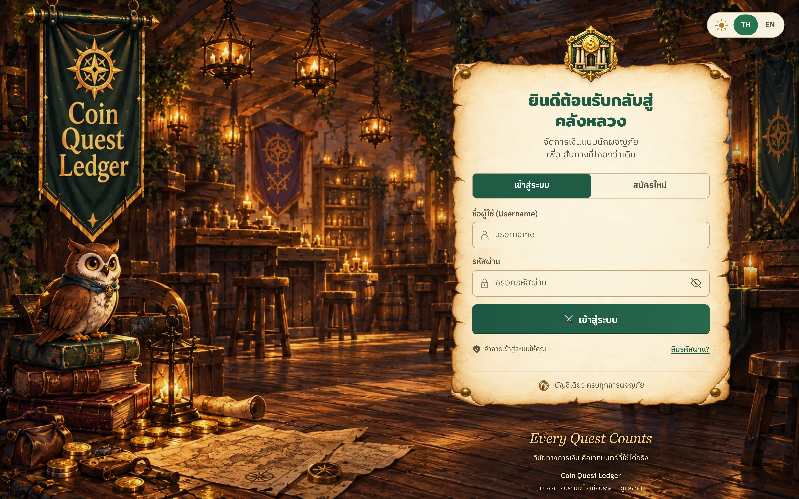
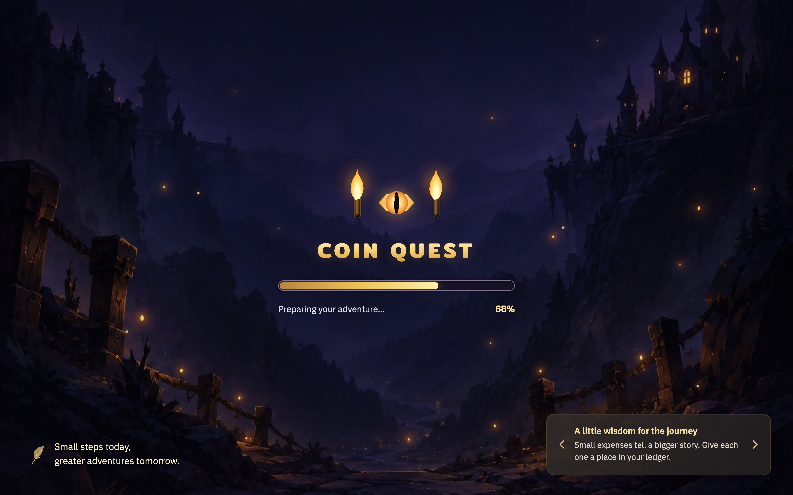
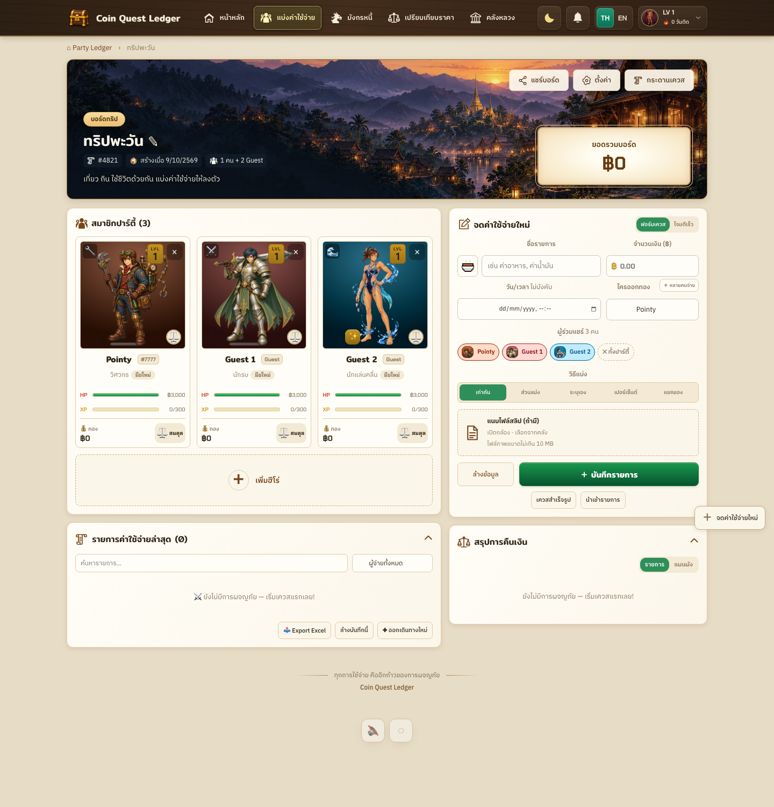
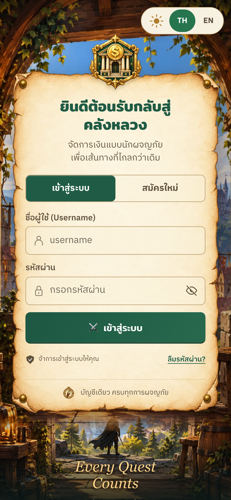

# Artwork ที่พาผู้เล่นผ่านทั้งแอป — คู่มือส่งต่อให้ Glenonchy

จัดทำ 17 ตุลาคม 2026 จากบทเรียนการออกแบบ Coin Quest Ledger และเอกสารปัจจุบันของ Glenonchy

**หลักสำคัญ: ออกแบบทุกหน้าให้เป็นสถานที่และประสบการณ์เดียวกัน แล้วปรับความเด่นของภาพตามสิ่งที่ผู้เล่นกำลังทำ** หน้าเข้าระบบมีหน้าที่ต้อนรับ หน้าอธิบายเกมมีหน้าที่สอน และหน้าเล่นมีหน้าที่ทำให้มองเห็นและควบคุมเกมได้ทันที

เอกสารนี้เป็นคู่มือทำงานและข้อเสนอสำหรับ Glenonchy ไม่ใช่คำสั่งเปลี่ยนแบรนด์ เพิ่มฟีเจอร์ หรือเริ่มทุก ticket พร้อมกัน ภาพ Coin Quest ด้านล่างเป็นตัวอย่างจากเอกสาร QA ที่ตรวจดูแล้วในรอบนี้ ใช้อธิบายองค์ประกอบ ไม่ใช่รายงานทดสอบ production รอบใหม่ และไม่ใช่ภาพเป้าหมายที่ Glenonchy ต้องลอกตาม

## 1. เริ่มจากโลกของ Glenonchy

สิ่งที่ตรวจพบในโปรเจกต์ปลายทาง:

- Glenonchy เป็นแอปสำรวจพื้นที่ธุรกิจและกิจกรรมด้วยมือถือ เริ่มจากร้านกาแฟและ Coffee Catch ไม่ใช่เกม RPG หรือระบบต่อสู้
- โลโก้ที่เจ้าของเลือกเป็นป้ายเหลืองทรงข้าวหลามตัด อาคารแดง และกลุ่มนกเดินข้ามทางม้าลาย ต้องรักษาไฟล์ต้นฉบับ ไม่วาดโลโก้ทดแทนหรือย้อมสีเอง
- Flutter shell ปัจจุบันมี Welcome → Quest Detail → Debug ready preview และ Progress จากข้อมูลตัวอย่าง ยังไม่มี login, เกมที่เล่นได้ หรือ backend จริงตามสถานะที่อ่าน
- สีที่ใช้ในโค้ดปัจจุบันคือเหลือง `#FFD900`, หมึก `#25291F`, กระดาษอุ่น `#FFFCF4`, เขียว `#48643F` และเขียวอ่อน `#E9EFDF` การเลือกโลโก้ยังไม่ได้ยืนยัน design tokens ทั้งระบบ
- Flutter เป็นชั้น UI; Flame จะเป็นชั้นเกมเมื่อถึง T02; Django เป็นเจ้าของ auth และกติกาธุรกิจเมื่อถึงงาน backend

**ข้อเสนอสำหรับทดลองทิศทางภาพ:** ย่านร้านเล็กที่อบอุ่น มีชีวิต และชวนสำรวจ ใช้รูปทรงป้าย อาคาร ทางเดิน ต้นไม้ แก้วกาแฟ และรายละเอียดจากสถานที่จริงที่มีสิทธิ์ใช้เป็นภาษาภาพ การนำกลุ่มนกมาเป็น mascot เพิ่มเติมต้องแยกเป็นข้อเสนอ ไม่ตีความว่าได้รับอนุมัติเพราะอยู่ในโลโก้

สิ่งที่ถ่ายทอดจาก Coin Quest คือวิธีสร้างภาพเป็นชุด การจัดพื้นที่ และการรักษาความอ่านง่าย ส่วน tavern, มังกร, กระดาษเก่า, อาวุธ และเศรษฐกิจแฟนตาซีเป็นอัตลักษณ์ของ Coin Quest

## 2. กำหนดภาษาภาพหนึ่งชุดก่อนวาดหลายหน้า

เขียน art direction สั้น ๆ ให้ตอบเรื่องต่อไปนี้ได้ แล้วใช้กับภาพทั้งชุด:

| เรื่อง | ต้องตัดสินใจอะไร | ตัวอย่างข้อเสนอสำหรับ Glenonchy |
|---|---|---|
| อารมณ์ | ผู้เล่นควรรู้สึกอย่างไร | เป็นมิตร อบอุ่น อยากเดินสำรวจ |
| ลายเส้น | คม/นุ่ม หนา/บาง รายละเอียดระดับไหน | ภาพ 2D ที่รูปทรงอ่านง่ายบนมือถือ รายละเอียดมากได้ตามขอบฉาก |
| มุมมอง | ด้านหน้า ด้านข้าง หรือมองจากบน | ฉากต้อนรับเลือกหนึ่งมุม; gameplay ใช้มุมที่ทำให้จับวัตถุได้ชัด |
| แสง | ทิศทาง อุณหภูมิ ความเข้ม | แสงร้านอุ่น โดยวัตถุที่ต้องจับแยกจากพื้นหลังได้ |
| สี | สีแบรนด์ สีพื้น และสีสถานะ | เหลืองใช้เน้นจุดสำคัญ หมึกสำหรับข้อความ พื้นอุ่นสำหรับอ่าน; สีเตือนมีความหมายคงที่ |
| วัสดุ | ภาพให้ความรู้สึกเป็นอะไร | ป้ายร้าน กระดาษเมนู ไม้ หรือผิวทาสี ตามทิศทางที่เลือก |
| รูปทรง | มุม ขอบ เงา สัดส่วนตัวละคร | ถ้วย เมล็ดกาแฟ ปุ่ม และไอคอนมาจากครอบครัวรูปทรงเดียวกัน |
| การเคลื่อนไหว | ขยับเพื่อบอกอะไร | เด้งสั้นเมื่อรับของสำเร็จ; ฉากหลังไม่แย่งความสนใจขณะเล่น |

เริ่มด้วยภาพทดสอบหนึ่งชุด: ฉากหนึ่งภาพ วัตถุเกมสองชนิด และตัวอย่าง panel/ปุ่ม วางรวมกันที่ขนาดมือถือจริง หากภาพแต่ละชิ้นดูคนละเกม ให้แก้ชุดเล็กนี้ก่อนผลิตภาพทุกหน้า

ความสม่ำเสมอไม่ได้แปลว่าทุกหน้าต้องใช้ภาพพื้นหลังเดียวกัน หน้าเดียวกันอาจมีฉากกว้างและฉากแนวตั้งต่างกัน แต่ต้องยังจำสถานที่ แสง และภาษารูปทรงได้

## 3. เส้นทางตั้งแต่เข้าแอปจนจบเกม

เส้นทางต่อไปนี้เป็นแบบสำหรับออกแบบตามช่วงพัฒนาจริง ไม่ได้หมายความว่าทุกหน้ามีอยู่แล้ว โดยเฉพาะ login/guest, gameplay และผลที่บันทึกกับ server

```text
เปิดแอป / เตรียมทรัพยากร
        ↓
ต้อนรับ → เข้าระบบหรือเข้าแบบ guest ตาม auth ที่กำหนด
        ↓
เลือกกิจกรรม → รายละเอียด → สอนเล่น / พร้อมเริ่ม
                                    ↓
                                  เล่นเกม ↔ พักเกม
                                    ↓
                                  สรุปผล
                                    ↓
                         เล่นอีกครั้ง / ดูความคืบหน้า
```

### ต้อนรับและ login: ทำให้รู้ว่าเข้ามาที่ไหน

ภาพทำหน้าที่สร้างบรรยากาศและความจำของแบรนด์ จัดพื้นที่ให้เห็นโลโก้ ชื่อ และการกระทำหลักชัดเจน ฉากอาจมีรายละเอียดได้มาก แต่บริเวณกรอกข้อมูลต้องนิ่งและอ่านง่าย

Coin Quest แบ่งฉาก desktop เป็นกลุ่มภาพเล่าเรื่องด้านซ้ายกับฟอร์มด้านขวา ส่วนมือถือเปลี่ยนเป็นฉากประตูแนวตั้งและฟอร์มคอลัมน์เดียว ไม่ย่อ desktop ทั้งหน้าให้เล็กลง



สำหรับ Glenonchy ใช้โลโก้ที่อนุมัติไว้กับฉากย่านหรือร้านเป็นจุดเริ่มต้น ปุ่มและช่องกรอกต้องเป็น widget จริง พื้นฟอร์มอาจเป็นแผ่นสีอุ่นเรียบ ๆ ที่สัมพันธ์กับเมนูร้าน ไม่จำเป็นต้องมีขอบกระดาษเก่าตาม Coin Quest

ในอนาคตหากผลิตภัณฑ์ใช้ guest session ก็ออกแบบทางเข้านั้นตามจริง อย่าเพิ่ม username/password, social login, OTP หรือช่องสมัครสมาชิกเพียงเพราะ mockup มีอยู่ เมื่อ keyboard เปิด ผู้เล่นต้องยังอ่าน error และเลื่อนไปกดปุ่มได้

### Loading: พาผ่านช่วงรอโดยไม่เห็นหน้าที่ยังประกอบไม่เสร็จ

ใช้เอกลักษณ์เล็ก ๆ ของแบรนด์เป็นจุดโฟกัส เช่นเครื่องหมายหรือพร็อพที่อนุมัติแล้ว ฉากอยู่เบื้องหลัง ส่วนสถานะและทางออกจากข้อผิดพลาดอยู่ใน UI จริง

บทเรียนจาก Coin Quest คือหน้าโหลดต้องสัมพันธ์กับความพร้อมจริง: layout, font, ภาพที่จำเป็น และข้อมูลแรกของหน้าต้องพร้อมก่อนเปิดให้เล่น หากโหลดผิดพลาดให้มีสถานะและลองใหม่ ไม่แสดงหน้าครึ่งสำเร็จ และไม่ค้างโดยไม่มีทางออก

สำหรับ Flutter/Flame ให้เตรียม asset และ config ที่ต้องใช้ในฉากนั้นก่อนเข้า `ready` และเริ่มจับเวลาเฉพาะเมื่อเล่นจริง อย่าเริ่มรอบระหว่างโหลด sprite อย่าดาวน์โหลดภาพทุกกิจกรรมหรือทุกหน้าที่ซ่อนอยู่เพื่อเปิดหน้าปัจจุบัน



การเปิดรายละเอียดเล็ก ๆ หรือรีเฟรชรายการในหน้าเดิมใช้ skeleton/สถานะรอเฉพาะส่วน รักษาฉากและข้อมูลที่ใช้ได้ไว้ ไม่บังเกมหรือทั้งแอปทุกครั้งที่มีคำขอข้อมูล กรณีจำเป็นต้องรอเพื่อเริ่มเกมจึงใช้หน้าหรือ overlay เตรียมเกม

หากมี tip ให้กระชับและสุ่มจากชุดที่จัดไว้ ผู้เล่นไม่ควรต้องกดลูกศรเพื่อผ่านเวลา ถ้าไม่มีค่าความคืบหน้าจริง อย่าสร้างเปอร์เซ็นต์ที่ดูเหมือนวัดความคืบหน้าได้แน่นอน

### Welcome / เลือกกิจกรรม: ให้รู้ทันทีว่าจะทำอะไรต่อ

ใช้ภาพช่วยจำกิจกรรม เช่นแก้วกาแฟหรือฉากร้านสำหรับ Coffee Catch ชื่อกิจกรรม วิธีเข้าร่วม และปุ่มไปต่ออยู่ในตำแหน่งสม่ำเสมอ แต่ละกิจกรรมมีภาพเฉพาะตัวภายใต้ art direction เดียวกัน

เมื่อมีเพียงกิจกรรมเดียว ให้จัดหน้าเพื่อกิจกรรมนั้นอย่างตั้งใจ ไม่เติมร้านสมมติหรือการ์ดว่างหลายใบเพื่อให้หน้าดูเต็ม ภาพสถานที่ต้องไม่ทำให้ผู้ใช้เข้าใจว่ามีเส้นทางหรือจุดบริการจริงที่ระบบยังไม่รองรับ

### รายละเอียดกิจกรรม: เชื่อมบรรยากาศกับสิ่งที่จะเล่น

ใช้ภาพจากครอบครัวเดียวกับ Welcome แต่ลดขนาดให้คำอธิบายและปุ่มเริ่มนำสายตา ลำดับควรเป็นชื่อกิจกรรม → ต้องทำอะไร → วิธีควบคุม → เงื่อนไขสำคัญ → เริ่ม

หากแสดงเวลา คะแนนผ่าน หรือรางวัล ให้มาจาก config/สถานะจริง ตัวเลข Coffee Catch ใน starter ยังเป็นสมมติฐานสำหรับ playtest จึงไม่ควรฝังลงภาพถาวร

### Ready / tutorial: ภาพต้องสอนการเล่นได้

แสดงหนึ่งการกระทำต่อครั้ง เช่นภาพมือเลื่อนตะกร้าซ้าย–ขวา พร้อมตัวอย่างวัตถุที่ต้องรับและต้องหลบ ใช้รูปร่างร่วมกับสีเพื่อบอกความต่าง ผู้เล่นควรตอบได้ว่า “ฉันควบคุมอะไร เก็บอะไร และอะไรทำให้เสียคะแนน”

อย่าใช้ภาพคัตซีนหรือ mascot ใหญ่จนพื้นที่แสดง gesture และปุ่มเริ่มหายไป ย้ำให้หยุดอยู่ในบริเวณปลอดภัยก่อนเล่นตามกติกา Glenonchy คำแนะนำนี้ต้องอ่านได้และไม่ฝังในฉาก

### Gameplay: สิ่งที่ต้องเห็นก่อนคือเกม

แยกพื้นที่อย่างชัดเจน:

```text
┌──────────────────────────┐
│ Safe area                │
│ คะแนน   เวลา      พักเกม │ ← HUD: ข้อมูลที่ดูได้ทันที
├──────────────────────────┤
│        วัตถุที่ตก         │
│                          │ ← Playfield: พื้นหลังรายละเอียดต่ำ
│        ตะกร้า            │
├──────────────────────────┤
│ พื้นที่ลาก / นิ้วมือ      │ ← ไม่ทับข้อมูลสำคัญ
│ Bottom safe area         │
└──────────────────────────┘
```

นี่เป็นแผนผังหน้าที่ ไม่ใช่ขนาดบังคับ พื้นที่สัมผัสและขอบเขตตะกร้าต้องทดลองบนเครื่องจริง

- ฉากหลังเบากว่าวัตถุที่ต้องโต้ตอบ ทั้งความต่างสว่าง–มืด ความคม และรายละเอียด
- เมล็ดกาแฟกับอุปสรรคต้องแยกด้วย silhouette ได้ ไม่อาศัยสีแดง/เขียวเพียงอย่างเดียว
- รักษาขนาด apparent size, จุดยึด และทิศแสงระหว่าง sprite เพื่อไม่ให้ตัวละครกระโดดตำแหน่งตอนเปลี่ยนเฟรม
- พื้นที่ชนต้องสัมพันธ์กับรูปร่างที่ผู้เล่นเห็น ของดูเหมือนเข้าตะกร้าแล้วไม่ติด หรือยังไม่แตะแล้วเสียคะแนน คือปัญหาการออกแบบร่วมกับกติกา
- เอฟเฟกต์รับของสำเร็จต้องสั้นและไม่บังวัตถุชิ้นถัดไป เอฟเฟกต์คะแนนไม่ควรถูกเข้าใจว่าให้รางวัลจริงแล้ว
- การตกแต่งไม่เพิ่ม input latency ไม่เปลี่ยนความเร็วการเล่นตามความเร็วโหลดภาพ และไม่แย่งการลากของผู้เล่น
- HUD คงตำแหน่งเมื่อเลขเปลี่ยน จำนวนหลักเพิ่ม หรือภาษาเปลี่ยน

ตัวอย่าง Coin Quest ฝั่ง gameplay แสดงแนวคิดเดียวกัน: ย้ายฉากไปอยู่ banner แล้วใช้พื้นสงบรองรับข้อมูลและปุ่ม ตัวละครยังมีเอกลักษณ์ของแต่ละคลาส แต่แบบฟอร์มและตัวเลขอ่านง่าย



Split เป็นเกมที่เน้นข้อมูล ไม่ใช่เกมรับวัตถุแบบ Coffee Catch จึงนำหลักการจัดลำดับความเด่นมาใช้ ไม่ยกเลย์เอาต์หลายคอลัมน์เข้าไปในสนามเล่นมือถือ

### Pause / resume / exit: ฉากและสถานะต้องสัมพันธ์กัน

ทำให้รู้ว่าเกมหยุดแล้วจริง ๆ: การเคลื่อนที่ เวลา และ input ของรอบต้องหยุดตาม lifecycle อย่าเพียงวางภาพ overlay ทับขณะที่เกมยังเดินอยู่ แสดง Resume เป็นทางไปต่อที่ชัดเจน และอธิบายผลของการออกจากรอบตามกติกาจริง

เมื่อแอปกลับจาก background ห้ามให้วัตถุกระโดดข้ามสนามจากเวลาที่ผ่านไป การกลับมาเล่นควรกลับสู่บริบทเดิม แอนิเมชันตกแต่งไม่ใช่เหตุผลให้เริ่มรอบใหม่เอง

### Results / progress: อธิบายผลก่อนเฉลิมฉลอง

ให้คะแนน ผลผ่าน/ยังไม่ผ่าน และการกระทำต่อไปนำสายตา ภาพฉลองเป็นส่วนเสริม ทำชุดสำเร็จและลองใหม่ให้รู้สึกอยู่ในโลกเดียวกันโดยไม่ทำให้ผู้เล่นรู้สึกถูกลงโทษ

ในโหมดที่เชื่อม backend ให้แยกสถานะตามจริง: จบรอบในเครื่อง → กำลังส่งผล → ส่งสำเร็จ/ส่งไม่สำเร็จ → ความคืบหน้าที่ server ยืนยันแล้ว การให้ภาพ badge พร้อมข้อความ “ได้รับแล้ว” ก่อน server ยืนยันสร้างความเข้าใจผิด ส่วน T02 local demo บันทึกและแสดงผลในเครื่องได้โดยระบุว่าเป็นผลทดลอง ไม่ต้องสร้าง backend ก่อนเพื่อทำหน้าผลลัพธ์นี้

Replay เริ่ม session เกมใหม่ ไม่ล้างความคืบหน้าเดิม และไม่ให้รางวัลซ้ำจากการแตะซ้ำ การสแกน QR ชี้ไปยังกิจกรรม ไม่ใช่หลักฐานอยู่หน้างานหรือคำสั่งรับรางวัลจริง ผล local demo ต้องไม่ปรากฏเป็นแต้ม production

## 4. แยกภาพออกเป็นชิ้นที่ทำงานร่วมกันได้

อย่าสั่งวาดทั้งหน้ารวมฟอร์ม ปุ่ม และข้อความแล้วนำมาใช้เป็นรูปเดียว ให้แยกตามหน้าที่:

| ชั้น | สิ่งที่อยู่ในชั้นนี้ | หลักจัดวาง |
|---|---|---|
| Environment | ร้าน ถนน ท้องฟ้า แสง | ครอบพื้นที่ได้ โดยมี focal point และจุดที่ยอมให้ crop |
| Readability treatment | พื้นเรียบ เงาหรือ gradient รองข้อความ | บริเวณข้อความคอนทราสต์คงที่ ไม่พึ่งความมืดเฉลี่ยทั้งภาพ |
| Surface | แผ่นเมนู panel กล่องข้อมูล | ขยายตามเนื้อหา ขอบไม่บิด ใช้วิธีแบ่งขอบ/มุมเมื่อจำเป็น |
| Character / prop | mascot ถ้วย เมล็ดกาแฟ badge | ไฟล์โปร่งใส พื้นที่รอบตัวพอดี ไม่มีขอบขาวดำหลงเหลือ |
| UI | หัวข้อ ฟอร์ม ปุ่ม สถานะ ตัวเลข | ข้อความและ controls จริง รองรับภาษา ขนาดตัวอักษร และ accessibility |
| Feedback | effect, highlight, animation | บอกผลการกระทำ โดยไม่ทับ controls หรือเปลี่ยนข้อมูลเอง |

สำหรับ sprite โปร่งใส การแสดงเต็มตัวด้วย contain เป็นสิ่งที่เหมาะสมได้ ส่วนฉากทึบเต็มกรอบมักต้อง crop อย่างตั้งใจ อย่าใช้กฎ crop เดียวกันกับทุกชนิดภาพ

ข้อความบนป้ายต้องอยู่ใน **พื้นที่ใช้ได้จริงของป้าย** ไม่ใช่ขอบสี่เหลี่ยมของไฟล์ทั้งหมด ป้ายที่มีมุมม้วน ขอบไหม้ ตะปู หรือส่วนโปร่งใสต้องเผื่อ inset หากเอียง ให้เอียงกลุ่มข้อความกับพื้นรองในระบบพิกัดเดียวกัน ตรวจทั้งข้อความสั้นและหลายบรรทัด ฟอร์มและข้อความอ่านยาวควรตั้งตรง

ตัวอย่างบทเรียนจากนกฮูก Coin Quest: ข้อความอาจอยู่กึ่งกลาง element แต่ยังต่ำหรือเลยกระดาษในสายตาได้ เพราะพื้นที่เนื้อกระดาษไม่สมมาตร จึงต้องตรวจจากรูปจริง ไม่แก้ด้วย `center` อย่างเดียว

## 5. ผลิต artwork อย่างเป็นระบบ

### เขียน brief ก่อน generate / วาด

ทุกชิ้นควรระบุหน้าที่ ขนาดแสดงผล สัดส่วน ตำแหน่งวัตถุหลัก พื้นที่ว่าง ตำแหน่ง UI ความโปร่งใส และสิ่งที่ห้ามติดมาด้วย พร้อม reference ของภาพในชุดที่อนุมัติแล้ว

ตัวอย่าง brief สำหรับ **ข้อเสนอฉาก Welcome ของ Glenonchy**:

> ภาพฉากแนวตั้งสำหรับหน้าต้อนรับแอปสำรวจย่านร้านค้า บรรยากาศอบอุ่น เป็นมิตร ใช้ลายเส้น สี แสง และสัดส่วนเดียวกับ style reference ที่อนุมัติ แสดงรายละเอียดอาคารและต้นไม้ตามขอบซ้ายขวา เว้นช่วงกลางสำหรับโลโก้และเนื้อหา UI จริง ส่วนล่างเว้นพื้นที่อ่านปุ่ม ห้ามวาดโลโก้ใหม่ ห้ามมีข้อความ ปุ่ม กรอบมือถือ QR หรือ watermark ในภาพ ส่งเฉพาะ environment และระบุจุดที่ crop ได้

ตัวอย่าง brief สำหรับ **เมล็ดกาแฟที่ใช้เล่น**:

> วัตถุเมล็ดกาแฟหนึ่งชิ้นสำหรับเกมรับของแนวตั้ง มุมมองและทิศแสงเดียวกับตะกร้าที่อนุมัติ silhouette ชัดเมื่อย่อถึงขนาดใช้งานจริง รายละเอียดภายในไม่แย่งเส้นขอบ พื้นหลัง alpha โปร่งใส ไม่มีฉาก ข้อความหรือเงาเป็นแผ่นทึบ ส่งบน canvas และจุดยึดเดียวกันกับ sprite ชุดเดียวกัน

การสร้างภาพครั้งต่อไปให้อ้างภาพชุดก่อนที่คัดแล้ว ไม่เริ่มจากคำว่า “สวย น่ารัก พรีเมียม” ใหม่ทุกครั้ง ตรวจรูปหลายชิ้นวางติดกันเพื่อเห็นความต่างของแสง มุมกล้อง ลายเส้น และสเกล

### ส่งมอบ asset พร้อมข้อมูลใช้งาน

ขั้นต่ำของแต่ละชิ้น:

```text
id / ชื่อไฟล์ / เวอร์ชัน
หน้าที่และหน้าที่ใช้
ต้นฉบับ / runtime derivative
ขนาด pixel / ขนาดใช้จริง / อัตราส่วน
alpha มีหรือไม่ / พื้นรองที่ทดสอบแล้ว
focal point / safe area / ส่วนที่ crop ได้
sprite frame size / pivot / visual bounds เมื่อเกี่ยวกับเกม
สถานะที่ต้อง preload / fallback เมื่อโหลดไม่ได้
ที่มา สิทธิ์ใช้ และข้อกำหนด attribution ที่ทราบ
```

เก็บ master ที่แก้ไขต่อได้ และ export ไฟล์ runtime แยกชื่อชัดเจน ภาพวาดละเอียดอาจใช้ PNG/WebP พร้อม alpha; ไอคอนรูปทรงเรียบอาจเหมาะกับ SVG การห่อ PNG ใน SVG ไม่ได้ทำให้กลายเป็น vector หรือเล็กลงโดยอัตโนมัติ

ลดขนาดโดยตรวจที่ขนาดใช้งานจริง ทั้งบนพื้นสว่างและมืด: silhouette, ใบหน้า, ขอบ alpha และรายละเอียดสำคัญยังชัดหรือไม่ ไม่ใช้เปอร์เซ็นต์บีบอัดเป็นเกณฑ์เดียว

ขนาดไฟล์กับความจำขณะ decode เป็นคนละเรื่อง ภาพ 2048×2048 แบบ RGBA ใช้พื้นที่ pixel ประมาณ 16 MiB แม้ไฟล์บีบอัดจะเล็ก ต้องวางแผนโหลดเป็นฉากและตรวจบนอุปกรณ์เป้าหมาย อย่าพรีโหลดภาพทุกเกมเพียงเพราะอยู่ใน asset catalog เดียวกัน

## 6. ทำให้ทุกหน้าดูเป็นแอปเดียวกัน

ใช้ shared theme/widgets สำหรับหัวหน้า ปุ่ม ช่องกรอก navigation, panel, badge, dialog และสถานะ feedback แยกตัวเลือกตามหน้าที่แทนการคัดลอกแล้วแก้สีใหม่ทุกหน้า

| ควรคงที่ทั้งแอป | เปลี่ยนตามกิจกรรมได้ |
|---|---|
| ฟอนต์และลำดับหัวข้อ | ฉากและพร็อพประจำร้าน |
| ความหมายสี ปุ่มหลัก/รอง/อันตราย | accent ของกิจกรรมภายใต้ palette หลัก |
| navigation, back และ pause | ขนาด playfield ตามรูปแบบเกม |
| panel, ช่องกรอก, error และ retry | ภาพสอนและเอฟเฟกต์เฉพาะกิจกรรม |
| ตำแหน่งและภาษาของสถานะ | ตัวละครและวัตถุเล่นที่มาจาก art family เดียวกัน |

ใช้ภาพที่เล่าเรื่องเฉพาะเกม ไม่ใช้ banner เดียวแทนทุกเกม แต่สีพื้นอ่านข้อมูลและ controls ต้องคงสายตาเดียวกัน เช่น Coin Quest เคยพบปัญหา Admin แต่ละ tab มีสีกระดาษต่างกันจนรู้สึกเป็นคนละผลิตภัณฑ์ วิธีแก้คือใช้ surface owner เดียวกัน

งาน Admin ของ Glenonchy ควรรับ palette/type/สถานะจากระบบเดียวกันในระดับที่เหมาะสม แต่ยังต้องอ่านข้อมูลและทำงานได้คล่อง ไม่จำเป็นต้องยกฉากเต็มหน้าของผู้เล่นไปใส่ Django admin

## 7. ออกแบบมือถือจากงานที่ผู้เล่นต้องทำ

Coin Quest เปลี่ยน composition ระหว่าง desktop กับมือถือ; Glenonchy เป็น mobile-first จึงควรเริ่มจากจอแนวตั้งที่เล็กจริง แล้วค่อยปรับให้จอใหญ่ขึ้น



- เว้น safe area, keyboard และบริเวณที่นิ้วบัง ทดสอบการลากจริงแทนการดู screenshot อย่างเดียว
- คงขนาดอ่านข้อความและปุ่ม อย่าย่อทั้ง canvas ของหน้า UI เพื่อให้ทุกอย่างเข้าได้พร้อมกัน
- เนื้อหาคำอธิบาย/ผลลัพธ์เลื่อนได้ แต่สนามเล่นต้องมีขอบเขตที่ตั้งใจ ไม่หลุดไปอยู่ใน scroll ของหน้า
- รูปประกอบที่อยู่ข้างฟอร์มบนจอใหญ่ อาจเปลี่ยนเป็นหัวภาพหรือรายละเอียดขอบบนบนมือถือได้
- ข้อความไทย อังกฤษ ชื่อยาว ตัวเลขหลายหลัก และขนาดตัวอักษรที่ผู้ใช้เพิ่มต้องไม่ล้นป้าย
- สถานะสำคัญต้องรับรู้ได้ด้วยข้อความหรือรูปร่างด้วย ไม่ใช้สี เสียง หรือ motion เป็นช่องทางเดียว
- ลดการเคลื่อนไหวตกแต่งได้โดยไม่ทำให้ feedback ของเกมหาย; แยกจากการเคลื่อนที่ที่เป็นส่วนของกติกา

## 8. สิ่งที่ไม่ควรเสียไปเพื่อให้เหมือน mockup

Artwork เป็นส่วนหนึ่งของผลิตภัณฑ์ จึงต้องตามสถานะและกติกาจริง:

1. Controls ที่วาดไว้ต้องมีหน้าที่จริง และชื่อปุ่มต้องบอกผลที่เกิดขึ้น
2. คะแนนและจำนวนรางวัลมาจากระบบ ไม่ใส่ค่าตัวอย่างเหมือนเป็นข้อมูลจริง
3. หน้าผลลัพธ์แสดงชัดว่าเป็น demo, กำลังยืนยัน หรือยืนยันแล้ว
4. ตะกร้าและวัตถุสวยขึ้นได้ แต่ hitbox, input, pause, replay และการส่งผลครั้งเดียวต้องยังถูกต้อง
5. เมื่อข้อมูล/ภาพเสีย ให้แสดง fallback หรือ retry ที่มีเหตุผล ไม่ตีความเป็น “ไม่มีข้อมูล” และไม่กลบ error ด้วย animation
6. ถ้าภาพ mockup ขัดกับกติกา ให้บันทึกว่าเก็บองค์ประกอบภาพใด และปรับ flow ตรงไหนเพื่อรักษาพฤติกรรมจริง
7. สิทธิ์ที่มีต้นทุนจริงยังปิดตามข้อกำหนด Glenonchy จนมี policy, budget และการตรวจครบ การออกแบบรูปคูปองไม่ใช่การเปิดใช้คูปอง

ตัวอย่าง Coin Quest: mockup มีสร้าง Hero ใหม่ในบอร์ด แต่ระบบจริงใช้การเชื่อมตัวละครและ Guest คนละแบบ เรารับดีไซน์การ์ดกับ popup มาใช้ โดยรักษา identity และ flow จริงไว้ หลักเดียวกันนี้ใช้กับ guest, QR และรางวัลของ Glenonchy

## 9. ลำดับทำงานที่ใช้ได้จริงกับ Glenonchy

1. **อ่านงานที่ทำอยู่และล็อกข้อเท็จจริง:** หน้านี้ให้ทำอะไร มีข้อมูลอะไรจริง และอะไรยังเป็น preview
2. **เลือกชุดภาพทดสอบ:** ฉาก Welcome + วัตถุ Coffee Catch + UI surface ให้เห็นบนจอเดียวกัน ใช้โลโก้เดิมเป็น reference คงที่
3. **เขียนแผนภาพรายหน้า:** ระบุภาพเด่น จุดอ่าน จุดกด focal point, safe area และสถานะที่ต้องรองรับ ก่อนผลิตภาพละเอียด
4. **ทดสอบการเล่นด้วยกราฟิกง่ายก่อน:** ตรวจตำแหน่งมือ ขนาดวัตถุ การมองเห็น การชน และ pause แล้วจึงลง artwork ที่ละเอียดในขอบเขต ticket เกม
5. **แยกและนำ asset ไปใช้:** environment, sprite, surface และ live UI คนละชั้น รักษาเจ้าของ game rules แยกจาก rendering
6. **ตรวจภาพชุดที่เกี่ยวข้อง:** เปิดทั้งหน้าและรายละเอียดที่ขนาดจริง ตรวจจอเล็ก/ใหญ่และตัวอักษรขยาย แก้สาเหตุใน shared owner ถ้าเป็นปัญหาร่วม
7. **บันทึกเหตุผลและข้อยกเว้น:** เหตุใดรูปนี้ต้องเว้นกลาง เหตุใดปุ่มอยู่ตรงนี้ และความต่างจาก reference คืออะไร เพื่อให้หน้าถัดไปต่อได้

เกณฑ์จบสำหรับงาน artwork หนึ่งหน้าหรือหนึ่ง flow:

- ผู้เล่นบอกได้ว่าหน้านี้ทำอะไร และเห็น action หลักโดยไม่ต้องค้น
- ฉาก วัตถุ และ UI ดูมาจากชุดเดียวกัน; ไม่มีภาพใดผิดแสงหรือสเกลอย่างเห็นได้ชัด
- ข้อความอ่านได้ ป้ายไม่ล้น ตัวละครไม่ถูก crop ส่วนสำคัญ ขอบโปร่งใสไม่มี halo
- รูปและ font ไม่เด้งเปลี่ยนตำแหน่งหลังเปิดหน้า; error มีทางไปต่อ
- ภาพ gameplay ไม่ทำให้จับวัตถุผิด มองไม่เห็นอุปสรรค หรือกด pause ไม่ได้
- ผลและรางวัลไม่สัญญาเกินสถานะระบบ; กติกาที่เกี่ยวข้องยังผ่านการทดสอบ
- มีภาพตรวจจาก build/state ที่ระบุได้ และแยก source review, widget test, build กับการเล่นบนเครื่องจริงตามหลักฐาน

คู่มือนี้ไม่ต้องการให้รัน QA ทั้งโปรเจกต์ทุกครั้ง เปลี่ยนไอคอนให้ตรวจขนาดจริงและจุดใช้; เปลี่ยน gameplay sprites ให้ตรวจการอ่านภาพ/การชน/ความเร็ว; เปลี่ยน shared shell จึงค่อยตรวจตัวแทนหลายหน้า

## 10. แบบฟอร์มสั้นสำหรับทุกหน้าที่จะทำต่อ

```text
หน้า / ticket:
สถานะจริง: preview / local playable / connected
หน้าที่ของหน้าในหนึ่งประโยค:
สิ่งที่ผู้เล่นต้องเห็นก่อน 1 → 2 → 3:
การกระทำหลักและผลที่เกิดจริง:

Artwork family / reference ที่อนุมัติ:
environment / subject / surface / live UI / feedback:
ตำแหน่ง UI และ quiet area:
focal point และการ crop:
safe area / keyboard / thumb zone:
ข้อความยาวและภาษาอื่น:

asset ที่ใช้ซ้ำ / asset ที่ต้องสร้าง:
ขนาดจริง / alpha / pivot / runtime format:
preload / loading / empty / error / retry:
กติกาและข้อมูลที่ห้ามเปลี่ยนเพราะ mockup:
สิ่งที่ต่างจาก reference พร้อมเหตุผล:
หลักฐานที่ต้องเห็นก่อนถือว่าเสร็จ:
```

## แหล่งอ้างอิงสำหรับแชตปลายทาง

Coin Quest ในเครื่องเดียวกันอยู่ที่ `/Users/point/toolbox`:

- [Player design system](../../PLAYER_DESIGN_SYSTEM.md) — shared owners และความต่างที่ตั้งใจระหว่างเกม
- [Auth artwork](../auth-guild-2026-10-14/README.md) และ [asset briefs](../auth-guild-2026-10-14/assets.json) — ตัวอย่างแยก environment, seal และ parchment
- [Loading readiness](../loading-readiness-2026-10-14/README.md) — full-page readiness และ local skeleton
- [Party layout](../split-party-layout-2026-10-14/README.md) — รักษา gameplay ขณะเปลี่ยน composition
- [Dragon assets](../debt-dragons-2026-10-15/README.md) — master/runtime, alpha และตรวจคุณภาพภาพบีบอัด

ให้ตรวจข้อมูลล่าสุดใน Glenonchy ก่อนนำไปใช้:

- `/Users/point/Projects/Glenonchy/AGENTS.md`
- `/Users/point/Projects/Glenonchy/assets/brand/README.md`
- `/Users/point/Projects/Glenonchy/docs/PROGRESS.md`
- `/Users/point/Projects/Glenonchy/docs/DECISIONS.md`
- `/Users/point/Projects/Glenonchy/docs/03-first-minigame.md`
- `/Users/point/Projects/Glenonchy/apps/mobile/lib/app/theme.dart`

จุดส่งต่อ: แชตที่เจ้าของระบุ `codex://threads/01a14913-67af-7870-8c83-f6157a81ea66` งานรอบนี้เป็นการสอนและส่งต่อหลักการ ไม่ได้แก้ runtime, สร้างภาพใหม่, เปลี่ยนไฟล์ใน Glenonchy หรือ deploy
