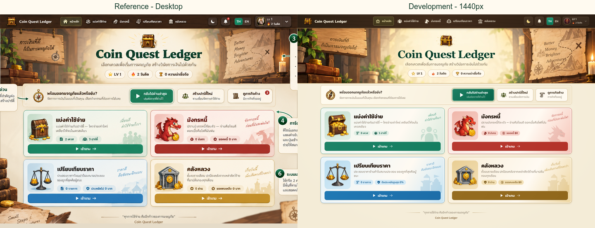
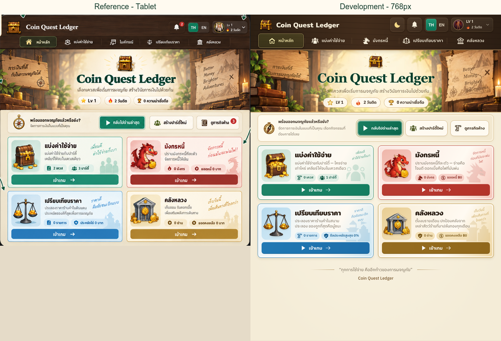
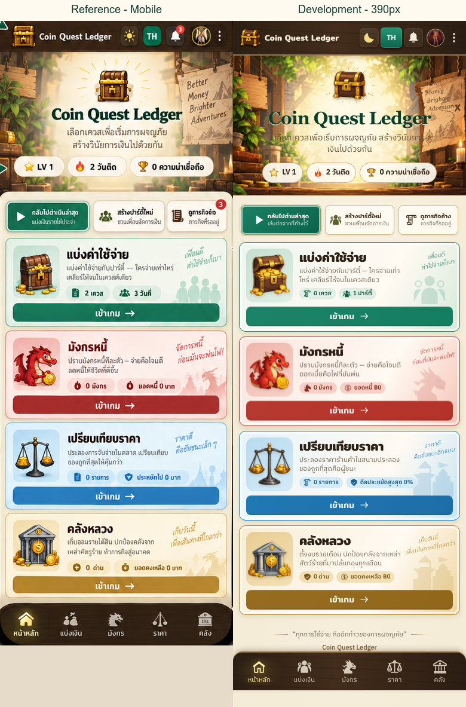

# Coin Quest Home and navigation — October 13, 2026

Scope: website at desktop 1440px, tablet 768px and phone 390px. The user explicitly
excluded the native app. Home, hero, quick actions, illustrated module cards,
navigation icons and shared player header follow the three supplied mockups.
Game forms, Admin, public Character Profile, Firebase schema and authentication
contracts are outside this redesign. Earlier uncommitted player-copy cleanup is
preserved separately in the working tree.

## Reference and implementation

Sources in `/Users/point/Downloads/`:

- `ChatGPT Image Oct 13, 2026, 03_22_42 PM-1.png`: desktop, 1448×1086 image.
- `ChatGPT Image Oct 13, 2026, 03_22_44 PM-2.png`: tablet, 1448×1086 image.
- `ChatGPT Image Oct 13, 2026, 03_22_45 PM-3.png`: phone, 1122×1402 image.

The authority is the inner application, excluding device frames, instructional
callouts and the surrounding infographic. Paired QA images use approximate
inner-screen crops: desktop `(147,229,1154,815)`, tablet `(299,175,852,785)`, phone
`(357,194,408,1093)`. Some annotations intrude into those source crops. Only crop,
uniform scaling and labels were applied for comparison; application screenshots
were not painted over.

The English hero uses Georgia as an inferred serif match; the screenshot does
not identify its original font. Product text retains Mitr, IBM Plex Sans Thai and
Chakra Petch. Composition follows the reference: dark wooden navigation,
illustrated tavern hero, real progress pills, three quick actions and four
colored module cards. Desktop/tablet are two columns; phone is one column.
The reference's phone is unusually tall: QA includes both a normal 390×844
viewport (scrollable, fixed bottom navigation) and a 390×1120 composition view.
English copy and dark mode are inferred product states absent from the mockups.
Blue/gold action fills are slightly deeper than the mockup so white button labels
meet 4.5:1 contrast; this is a deliberate readability adaptation.

## Owners and preserved contracts

| Surface | Owner | Behavior |
| --- | --- | --- |
| Home | `shared/home.js`, `shared/home.css`, root `index.html` | Live progress and module totals; semantic links into existing games |
| Shared navigation | `shared/mobile-shell.js`, `shared/navigation.css` | Home/Compare, Split, Debt and Treasury; active route, back history, language, theme, profile and reminders |
| Icons | `shared/quest-icons.js` | Native SVG controls and decorative silhouettes; decorative glyphs hidden from assistive technology |
| Artwork | `assets/home-reference/*.webp` | Generated crest, open chest, red dragon, scales, treasury, wide and phone tavern backgrounds |
| Create party shortcut | `trip/app.js` | `?action=new` opens the existing setup form once; no board is created until the existing submit flow |
| Resume | account-scoped `coin_quest_recent_route_v1` | Last allowed module route; fresh accounts see a start action; arbitrary external URLs rejected |

No mockup numbers are hardcoded. Quest/party counts, debt balance, treasury
remaining amount, streak, level, reputation and reminder badges use current
account data. Compare shows the canonical best saving **percentage** because
the product does not have a meaningful cumulative saved-baht metric. Treasury
can display a negative remaining balance when spending exceeds income.

The phone overflow menu has dialog semantics, background inertness, body scroll
lock, keyboard focus containment/restoration and Escape dismissal. Language/theme
changes within it retain focus. Normal navigation links retain modified-click
behavior. Profile and reminders keep their existing implementations.

Removed the old `shared/mobile-shell.css`, duplicated inline header rules in all
four player entry points, obsolete Home styles/rendering in root HTML, old
header sizing overrides in profile CSS and emoji-based navigation. Detached
historical restoration styles remain documented historical files; they are not
loaded by the current app.

## Artwork provenance

Artwork was recreated with the built-in image generation tool using the supplied
screenshots as references. These are original recreations, not recovered source
assets or a claim of pixel-identical artwork. Text, headings, metrics and buttons
are real HTML. All seven served files together are approximately 280 KB of WebP;
PNG masters for the first six assets are retained beside them.

Generation briefs:

- Wide tavern: warm storybook tavern, wooden plaque on the left, parchment map on
  the right, plants/books/coins/candle at the edges, pale cream center. No title,
  central chest, UI, labels or writing; signage copy is rendered as HTML.
- Module icons: each generated separately with transparent background, centered
  at roughly 82% of a square; hand-painted storybook outlines matching the desktop
  reference. Open gold-banded chest with coins, friendly red dragon facing right
  holding a coin, steel balance with coin pans, classical gray treasury with a
  large golden coin. No text, card surface or extra scene.
- Crest: closed rounded wooden treasure chest with heavy gold bands and centered
  keyhole, transparent background, same illustration family.
- Phone tavern: responsive 5:3 recomposition from the wide tavern and phone
  reference; leftmost 18% holds wood/plants/books, rightmost 23% a parchment map
  and candle, central 60% a quiet cream opening. No UI, chest, writing or frame.

Wide and icon originals: Codex generated image task
`01a12b87-cf17-7193-a1a2-63c61768c511`. Phone source is
`exec-b3fff613-7910-4be3-a6a2-57ace9562f1f.png` in that task's generated image
directory. Served files use WebP quality 86–88: icons 320px, wide background
1800px, phone background 900px. SVG navigation icons are hand-authored.

## Verification and limits

Local working-tree build based on `df55bc787a5bb0f95d001a4a234a1b3d8c110cdd`;
no commit, push or deployment in this task. Origin `http://127.0.0.1:4569`.
Screenshots in `qa/` use an explicitly synthetic TEST account, zero financial
balances, one party and a two-day streak, Thai unless named English. Fonts and
visible image loading were checked before capture. No production writes.

- `test:syntax`: 46 browser scripts and 18 module files passed.
- `test:assets`: 58 deployed local assets plus 47 existing CDN manifest entries passed.
- Account persistence/auth fault-injection E2E: 9 Chromium tests passed with the
  new shared header; Firebase transport is stubbed, production-mode UI is real.
- Final navigation E2E: 6 Chromium tests passed. Home geometry at all three
  widths, loaded icons, no horizontal overflow, Compare/history/active tabs,
  language, dark theme, profile, reminders, new-party form, focus behavior and
  navigation through all four modules at all three widths.
- Interactive Chrome check: Home → Compare → Home through the real navigation.
- Current desktop/tablet/phone, phone English and dark screenshots inspected.
  Fixed first-pass mobile art crop, English action overflow and tablet density.
- `git diff --check` passed.

Visual verdict: reference-led implementation with declared artwork/font and
content adaptations; no pixel-perfect identity claim. Functional verdict:
verified for the touched local surfaces above. Full finance regression, Safari,
Android browsers, native Simulator, Admin and production deploy checks were not
rerun because this change does not alter their contracts.

