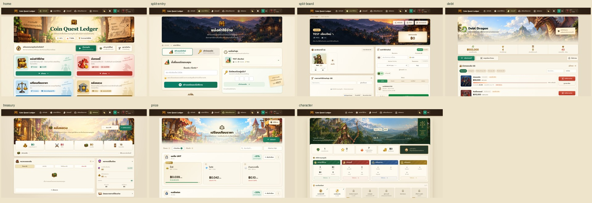
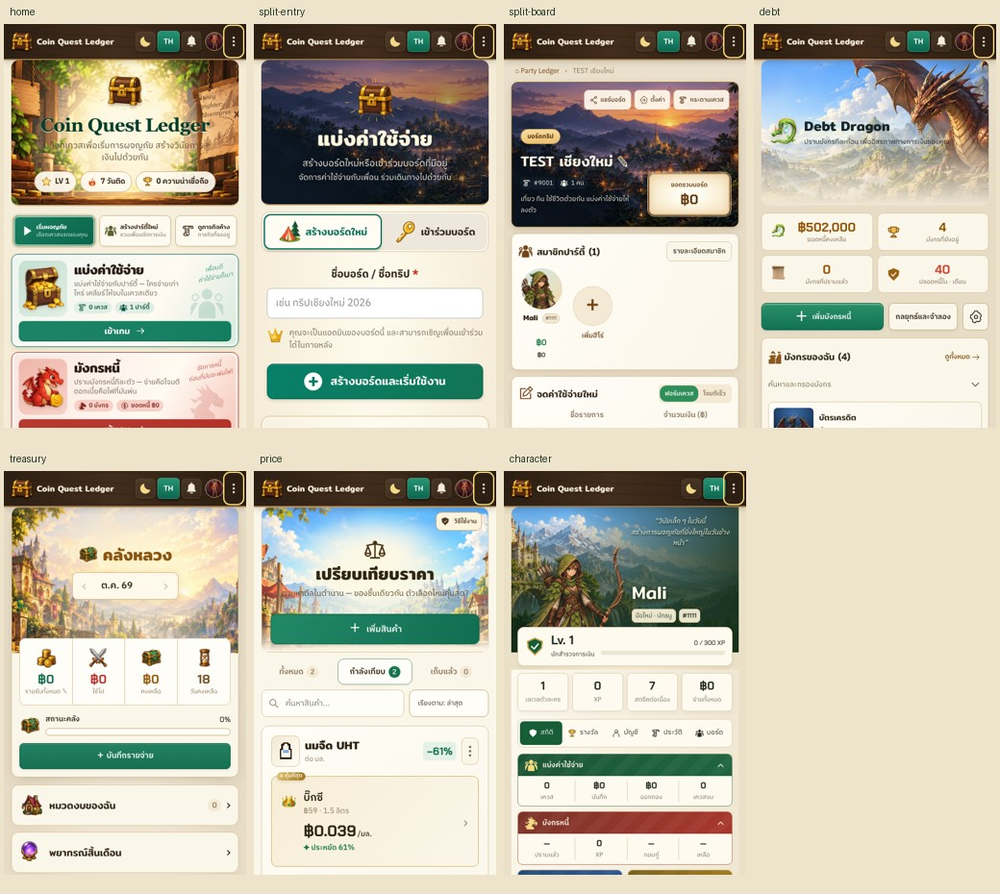

# Shared player design consolidation — 2026-10-13

Scope: player website Home, Party Ledger entry/board, Debt Dragon, Treasury,
Price Arena and Character. Local changes only; no push/deploy, native/Admin or
Firebase/data-contract changes in this task. Existing unrelated work was kept.

The user's clarification is binding: **artwork should differ between games**.
Consistency means shared product components and a coherent family within each
game, including older/unredesigned states. It does not mean identical pictures,
card layouts or game mechanics everywhere.

## Result

- Added `shared/player-layout.js` for actual shared header/footer elements;
  removed repeated route header markup and superseded footer CSS.
- Reused the navigation/menu implementation on public Character pages,
  preserving privacy, admin return and contextual phone actions. Missing account
  actions are omitted instead of presenting buttons without working handlers.
- Added `shared/player-layout.css` for frame/gutter, banner scales, family
  artwork variables and footer styling. Route CSS owns local composition.
- Party entry now uses the board's village family with readable text/overlay.
  Home, Debt, Treasury, Price and Character retain their different artwork.
- Standard game banners measure 260px / 220px / ~234px at 1440 / 768 / 390px.
  Header heights measure 68px / 109px / 58px across all seven routes. Scenic
  frames align within 2px (Treasury's border); portrait and long-content variants
  remain explicit. See `qa/metrics-*.json`.
- Documented the durable contract in `PLAYER_DESIGN_SYSTEM.md` and linked it from
  Memory, Playbook, structure and architecture docs. Updated and validated both
  versioned and installed `coin-quest-new-chat` copies; all three files match.

## Verification

26 unique targeted Chromium E2E cases passed across the runs in this task:

- 4 shared consistency/menu tests: seven routes at 1440/768/390, shared frame and
  banner measurements, no overflow, artwork family, footer/header, phone menu
  keyboard dismissal; profile menu language/theme/rerender/focus and deep links.
- 6 existing navigation/Home cases: desktop/tablet/phone, all four games,
  language/theme, active destination and navigation behavior.
- 8 existing Character cases: composition/privacy, archive/reopen, public
  visitor isolation, long-name dark/narrow layout, copy, admin return and keyboard
  disclosure. Updated the phone language selector to the shared compact control
  and used an awaited assertion for its existing responsive panel reordering.
- 8 targeted module journeys: Split create/reopen and board expense save, Debt
  create/validate/edit/pay/reload, Treasury validate/save/reopen, each at 1440/390.

Syntax: 49 browser scripts and 27 module files. Asset validation: 92 deployed
local assets and 47 optional CDN manifest entries. Both Skill validations and
`git diff --check` passed. Real browser screenshots were personally inspected.

Initial checks caught the old Character EN-button selector, a resize assertion
that ran before the responsive callback, and Treasury's old negative phone
margin. These were repaired; no assertions/budgets were weakened to mask them.

This is deterministic local `?test=1` evidence. It does not prove real Firebase
account flows, production, native Simulator, Safari or the full regression suite.
Those unrelated gates were intentionally skipped for this presentation task.

## Images and provenance

`qa/before-{route}-{width}.png` and `qa/after-{route}-{width}.png` are full browser
captures from `http://127.0.0.1:4569`, Thai/light, 1440×1000, 768×1000 and 390×844.
Data comes from local TEST fixtures/defaults, not live accounts. References for
individual games remain in their dated redesign folders. The comparison sheets
are labeled crops of actual captures, not generated or composited product UI.





Run the focused shared contract check with the project's existing Node/browser
setup:

```sh
POINTY_REAL_FIREBASE_E2E=0 npx playwright test tests/e2e/player-consistency.spec.mjs --project=chromium
```
